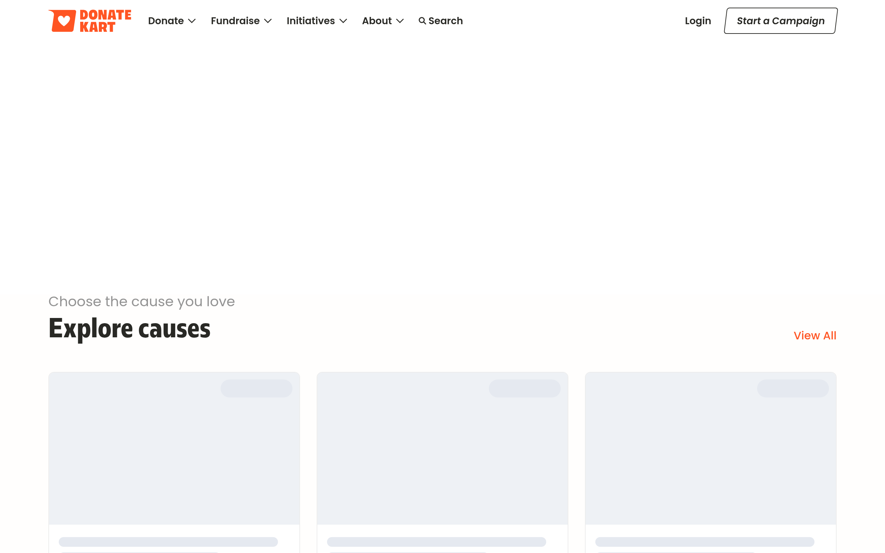
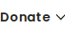
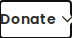
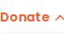
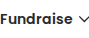
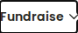
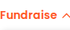
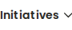
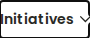
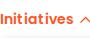

# donatekart Design System

You are building UI for **donatekart**. Dark-themed, cool palette, sans-serif typography (Redonda Black), compact density on a 4px grid, expressive motion.

## Visual Reference

**IMPORTANT**: Study ALL screenshots below before writing any UI. Match colors, typography, spacing, layout, and motion exactly as shown.

### Homepage



### Scroll Journey (Cinematic Visual States)

> These screenshots capture the website at different scroll depths. The design changes dramatically as you scroll — each frame shows a different cinematic state. Replicate these exact visual transitions.

#### 0% — Hero / Above the fold


#### 17% — Mid-page at 17% scroll


#### 33% — Mid-page at 33% scroll


#### 50% — Mid-page at 50% scroll


#### 67% — Mid-page at 67% scroll


#### 83% — Mid-page at 83% scroll


#### 100% — Footer / End of page


> Read `references/DESIGN.md` for full token details. Read `references/ANIMATIONS.md` for motion specs. Read `references/LAYOUT.md` for layout structure. Read `references/COMPONENTS.md` for component patterns.

## Ultra Reference Files

This package includes extended documentation. **Read these files before implementing:**

| File | Contents |
|------|----------|
| `references/DESIGN.md` | Full design system tokens, colors, typography, spacing |
| `references/VISUAL_GUIDE.md` | **START HERE** — Master visual guide with all screenshots embedded |
| `references/ANIMATIONS.md` | CSS keyframes, scroll triggers, motion library stack, video specs |
| `references/LAYOUT.md` | Flex/grid containers, page structure, spacing relationships |
| `references/COMPONENTS.md` | DOM component patterns, HTML structure, class fingerprints |
| `references/INTERACTIONS.md` | Hover/focus states with before/after style diffs |
| `screens/scroll/` | 7 scroll journey screenshots showing cinematic states |

### Animation Stack Detected

- **Web Animations API (17 active)** — animation

## Design Philosophy

- **Layered depth** — use shadow tokens to create a sense of physical layering. Each elevation level has a specific shadow.
- **Gradient accents** — gradients are used thoughtfully for emphasis, not decoration.
- **Type pairing** — Redonda Black for body/UI text, Redonda Bold for headings/display. Never introduce a third typeface.
- **compact density** — 4px base grid. Every dimension is a multiple of 4.
- **cool palette** — the color temperature runs cool, matching the sans-serif typography.
- **Restrained accent** — `#007bff` is the only pop of color. Used exclusively for CTAs, links, focus rings, and active states.
- **Expressive motion** — animations are an integral part of the experience. Use spring physics and layout animations.

## Color System

### Core Palette

| Role | Token | Hex | Use |
|------|-------|-----|-----|
| Background | `--background` | `#212529` | Page/app background |
| Surface | `--surface` | `#343a40` | Cards, panels, modals |
| Text Primary | `--text-primary` | `#ffffff` | Headings, body text |
| Text Muted | `--text-muted` | `#939393` | Captions, placeholders |
| Accent | `--accent` | `#007bff` | CTAs, links, focus rings |

### Status Colors

| Status | Hex | Use |
|--------|-----|-----|
| Success | `#28a745` | Confirmations, positive trends |
| Warning | `#ffc107` | Caution states, pending items |
| Danger | `#ff5523` | Errors, destructive actions |

### Extended Palette

- **border-primary:** `#e7e7e7` — Light surface or highlight color
- `#000000` — Deep background layer or shadow color
- **secondary:** `#0069ff` — Secondary text, placeholder text
- `#d1d1d1`
- `#f6f6f6` — Light surface or highlight color
- `#c2c2c2`
- **info:** `#17a2b8`
- **danger:** `#dc3545` — Destructive actions, error states

### CSS Variable Tokens

```css
--primary: #007bff;
--secondary: #6c757d;
--primary: #ff5523;
--primary-rgb: 255,85,35;
--primary-hover: #e64d20;
--primary-hover-rgb: 230,77,32;
--primary-active: #cc441c;
--primary-active-rgb: 204,68,28;
--primary-light: #ffeee9;
--primary-light-rgb: 255,238,233;
--primary-light-hover: #ffe6de;
--primary-light-hover-rgb: 255,230,222;
--secondary: #0069ff;
--secondary-rgb: 0,105,255;
--secondary-light: #e6f0ff;
--secondary-light-rgb: 230,240,255;
--secondary-hover: #005fe6;
--secondary-hover-rgb: 0,95,230;
--text-primary: #292925;
--text-primary-rgb: 41,41,37;
```

## Typography

### Font Stack

- **Redonda Black** — Heading 1, Heading 2, Heading 3
- **Redonda Bold** — Body, Caption
- **SFMono-Regular** — Code

### Font Sources

```css
@font-face {
  font-family: "Redonda Bold";
  src: url("fonts/RedondaBold-700.otf") format("opentype");
  font-weight: 700;
}
@font-face {
  font-family: "Redonda Black";
  src: url("fonts/RedondaBlack-900.otf") format("opentype");
  font-weight: 900;
}
@font-face {
  font-family: "Poppins";
  src: url("fonts/Poppins-Bold.ttf") format("truetype");
  font-weight: 700;
}
@font-face {
  font-family: "Poppins";
  src: url("fonts/Poppins-Regular.ttf") format("truetype");
  font-weight: 400;
}
```

### Type Scale

| Role | Family | Size | Weight |
|------|--------|------|--------|
| Heading 1 | Redonda Black | 48px | 700 |
| Heading 2 | Redonda Black | 40px | 700 |
| Heading 3 | Redonda Black | 36px | 700 |
| Body | Redonda Bold | 14px | 400 |
| Caption | Redonda Bold | 16px | 400 |
| Code | SFMono-Regular | 14px | 400 |

### Typography Rules

- Body/UI: **Redonda Black**, Headings: **Redonda Bold** — these are the only display fonts
- Max 3-4 font sizes per screen
- Headings: weight 600-700, body: weight 400
- Use color and opacity for text hierarchy, not additional font sizes
- Line height: 1.5 for body, 1.2 for headings

## Spacing & Layout

### Base Grid: 4px

Every dimension (margin, padding, gap, width, height) must be a multiple of **4px**.

### Spacing Scale

`2, 4, 6, 8, 10, 12, 14, 16, 18, 20, 22, 24` px

### Spacing as Meaning

| Spacing | Use |
|---------|-----|
| 4-8px | Tight: related items (icon + label, avatar + name) |
| 12-16px | Medium: between groups within a section |
| 24-32px | Wide: between distinct sections |
| 48px+ | Vast: major page section breaks |

### Border Radius

Scale: `0px 6px 6px 0px, 0px 6px 0px 0px, 0px 0px 0px 6px, 0px 0px 6px, 0px 0px 8px 8px, .2rem, .25rem, .3rem, 1px, 2px, 4px, 6px, 6px 0px 0px 6px, 6px 0px 0px, 7px, 8px, 8px 8px 0px 0px, 10px, 11px, 12px, 15px, 16px, 20px, 24px, 28px, 32px, 34px, 35px, 50px, 50rem, 70px, 999px`
Default: `8px 8px 0px 0px`

### Container

Max-width: `991px`, centered with auto margins.

### Breakpoints

| Name | Value |
|------|-------|
| xs | 400px |
| xs | 420px |
| xs | 450px |
| sm | 509px |
| sm | 575px |
| sm | 576px |
| md | 760px |
| md | 767px |
| md | 768px |
| lg | 991px |
| lg | 992px |
| lg | 1024px |
| xl | 1025px |
| xl | 1080px |
| xl | 1199px |
| xl | 1200px |

Mobile-first: design for small screens, layer on responsive overrides.

## Component Patterns

### Card

```css
.card {
  background: #343a40;
  border-radius: 8px 8px 0px 0px;
  padding: 16px;
  box-shadow: -4px 4px 8px rgba(0,0,0,.2);
}
```

```html
<div class="card">
  <h3>Card Title</h3>
  <p>Card content goes here.</p>
</div>
```

### Button

```css
/* Primary */
.btn-primary {
  background: #007bff;
  color: #ffffff;
  border-radius: 8px 8px 0px 0px;
  padding: 8px 16px;
  font-weight: 500;
  transition: opacity 150ms ease;
}
.btn-primary:hover { opacity: 0.9; }

/* Ghost */
.btn-ghost {
  background: transparent;
  border: 1px solid #444444;
  color: #ffffff;
  border-radius: 8px 8px 0px 0px;
  padding: 8px 16px;
}
```

```html
<button class="btn-primary">Get Started</button>
<button class="btn-ghost">Learn More</button>
```

### Input

```css
.input {
  background: #212529;
  border: 1px solid #444444;
  border-radius: 8px 8px 0px 0px;
  padding: 8px 12px;
  color: #ffffff;
  font-size: 14px;
}
.input:focus { border-color: #007bff; outline: none; }
```

```html
<input class="input" type="text" placeholder="Search..." />
```

### Badge / Chip

```css
.badge {
  display: inline-flex;
  align-items: center;
  padding: 4px 8px;
  border-radius: 9999px;
  font-size: 12px;
  font-weight: 500;
  background: #343a40;
  color: #939393;
}
```

```html
<span class="badge">New</span>
<span class="badge">Beta</span>
```

### Modal / Dialog

```css
.modal-backdrop { background: rgba(0, 0, 0, 0.6); }
.modal {
  background: #343a40;
  border-radius: 999px;
  padding: 24px;
  max-width: 480px;
  width: 90vw;
  box-shadow: 0 0 10px rgba(0,0,0,.1);
}
```

```html
<div class="modal-backdrop">
  <div class="modal">
    <h2>Dialog Title</h2>
    <p>Dialog content.</p>
    <button class="btn-primary">Confirm</button>
    <button class="btn-ghost">Cancel</button>
  </div>
</div>
```

### Table

```css
.table { width: 100%; border-collapse: collapse; }
.table th {
  text-align: left;
  padding: 8px 12px;
  font-weight: 500;
  font-size: 12px;
  color: #939393;
  text-transform: uppercase;
  letter-spacing: 0.05em;
  border-bottom: 1px solid #444444;
}
.table td {
  padding: 12px;
  border-bottom: 1px solid #444444;
}
```

```html
<table class="table">
  <thead><tr><th>Name</th><th>Status</th><th>Date</th></tr></thead>
  <tbody>
    <tr><td>Item One</td><td>Active</td><td>Jan 1</td></tr>
    <tr><td>Item Two</td><td>Pending</td><td>Jan 2</td></tr>
  </tbody>
</table>
```

### Navigation

```css
.nav {
  display: flex;
  align-items: center;
  gap: 8px;
  padding: 12px 16px;
}
.nav-link {
  color: #939393;
  padding: 8px 12px;
  border-radius: 8px 8px 0px 0px;
  transition: color 150ms;
}
.nav-link:hover { color: #ffffff; }
.nav-link.active { color: #007bff; }
```

```html
<nav class="nav">
  <a href="/" class="nav-link active">Home</a>
  <a href="/about" class="nav-link">About</a>
  <a href="/pricing" class="nav-link">Pricing</a>
  <button class="btn-primary" style="margin-left: auto">Get Started</button>
</nav>
```

### Extracted Components

These components were found in the codebase:

**Button** (`html`)
- Variants: `_17pl3`, `_1zHni`, `DonateNow__1MuF4`, `_1VBbu`

**Input** (`html`)

## Page Structure

The following page sections were detected:

- **Navigation** — Top navigation bar (3 items)
- **Hero** — Hero section (detected from heading structure)
- **Faq** — FAQ/accordion section
- **Footer** — Page footer with links and info (23 items)

When building pages, follow this section order and structure.

## Animation & Motion

This project uses **expressive motion**. Animations are part of the design language.

### CSS Animations

- `popup_slideUp__27rJi`
- `otp-input_blink__2HqqG`
- `spinner_osahanloading__1Rsnl`
- `fa-beat`
- `fa-bounce`

### Motion Tokens

- **Duration scale:** `0s`, `1ms`, `10s`, `15s`, `150ms`, `200ms`, `250ms`, `300ms`, `500ms`, `1000ms`
- **Easing functions:** `ease-in-out`, `ease-out`, `ease`

### Motion Guidelines

- **Duration:** Use values from the duration scale above. Short (0s) for micro-interactions, long (1000ms) for page transitions
- **Easing:** Use `ease-in-out` as the default easing curve
- **Direction:** Elements enter from bottom/right, exit to top/left
- **Reduced motion:** Always respect `prefers-reduced-motion` — disable animations when set

## Depth & Elevation

### Shadow Tokens

- Subtle: `0 1px 2px rgba(0,0,0,.1)`
- Subtle: `0 1px 2px rgba(0,0,0,.2)`
- Raised (cards, buttons): `-4px 4px 8px rgba(0,0,0,.2)`
- Raised (cards, buttons): `0 1px 3px rgba(0,0,0,.1)`
- Raised (cards, buttons): `0 .125rem .25rem rgba(0,0,0,.075)`
- Raised (cards, buttons): `0 .5rem 1rem rgba(0,0,0,.15)`

### Z-Index Scale

`0, 1, 2, 3, 4, 5, 6, 7, 9, 10, 90, 98, 99, 100, 199, 999, 1000, 1005, 1020, 1030, 1040, 1050, 1070, 10000, 10007, 10008, 10009, 10010, 100001, 100002, 1000009, 2147483647`

Use these exact values — never invent z-index values.

## Anti-Patterns (Never Do)

- **No blur effects** — no backdrop-blur, no filter: blur()
- **No zebra striping** — tables and lists use borders for separation
- **No invented colors** — every hex value must come from the palette above
- **No arbitrary spacing** — every dimension is a multiple of 4px
- **No extra fonts** — only Redonda Black and Redonda Bold and SFMono-Regular are allowed
- **No arbitrary border-radius** — use the scale: .2rem, .25rem, .3rem, 1px, 2px, 4px, 6px, 7px, 8px, 10px
- **No opacity for disabled states** — use muted colors instead

## Workflow

1. **Read** `references/DESIGN.md` before writing any UI code
2. **Pick colors** from the Color System section — never invent new ones
3. **Set typography** — Redonda Black, Redonda Bold, SFMono-Regular only, using the type scale
4. **Build layout** on the 4px grid — check every margin, padding, gap
5. **Match components** to patterns above before creating new ones
6. **Apply elevation** — use shadow tokens
7. **Validate** — every value traces back to a design token. No magic numbers.

## Brand Spec

- **Favicon:** `data:image/vnd.microsoft.icon;base64,iVBORw0KGgoAAAANSUhEUgAAACAAAAAgCAYAAABzenr0AAAC00lEQVR4AcRXTWsTQRh+3tlKKFXR0h7UYq2prReV1mMPrYKiF6nVUoqIngUVLIJ/wJOg6B/Qg0hrquIXgloQUQ8eTL2IaBpFVBD04gf2kOb12U262W1mtx+YZHmfmfdrZp4d5p1sjA4mn9QSBkBvLUEC+pQEaiZGUlnugB4ig79E1YU7AJDENUB3owaPR8BdlySesb9PVFV8At6qKs+9vopNmIDoryqu7S01l8BazxvffGf4Bc/MJPs4STP4iYiVMAHFppjs31AMS2qqmejhmelCXrqZ/4UoieoF5JY1MaebaIXRTgYnCKuECUA6rFmuU3S/jE+Nuuos5EYmDSMsY/ws+GRExrOn5NbbHwUbkLHsOyDRD+ArUSZzCETtgNyT69nHZaPpkLHMFLuTEE1JKnOeeplI6g13T8+VBejwCehgxzra9YRNXtmcvq9hZpQEzvq2TXGM9cb1CUBzm23jCj51Cr29lSsfp2Xsw2t7tOjVfGNRC3UlApD2UCRsbAmbS7K220YFCHin1Zbj+nZp/4ZVrrIUaF9fHVSO2caWCIiJK8F61DmnbRMsyNf8+Qjz1hNlUiKA2B0ABCM61O7WPRbz6EDrGl5a1gpw5wkQiCpBN81DAnm9rcMdTZ610Mapu8rU1YRVPAJ6YGPc9gcHtiA381APb20IOqN0fupdZmwnESkeATjzvn1wgi5M/7mrgy1Rd4aXqweTF6kcJWKlQEAXRcCdcAeQeKT7Ole4RhAk1sg3n+CZORH0R+kFAjDuD0ZUTpS/B4lcWofats0m6EBbK4m9pB277Yz7UiSAuEvIT7YoSeTNJLf7ON96DxzHvbKTlrxIV5HAPCUYObwYEFyi9oDlZr1uGYsUo3vbE4xaLwn6Ky4GK3WhJVgRMgYzGv0RUpElw5MalkuNCUCWhzlV1XpvAHHrFjV5VM/wv2HmDiAjAL4R/10iJkxDTC8/YG/+AwAA//+kRqIvAAAABklEQVQDAPvG84M5B3DeAAAAAElFTkSuQmCC`
- **Site URL:** `https://www.donatekart.com/`
- **Brand color:** `#007bff`
- **Brand typeface:** Redonda Black

## Quick Reference

```
Background:     #212529
Surface:        #343a40
Text:           #ffffff / #939393
Accent:         #007bff
Border:         (not extracted)
Font:           Redonda Black
Spacing:        4px grid
Radius:         8px 8px 0px 0px
Components:     7 detected
```

## When to Trigger

Activate this skill when:
- Creating new components, pages, or visual elements for donatekart
- Writing CSS, Tailwind classes, styled-components, or inline styles
- Building page layouts, templates, or responsive designs
- Reviewing UI code for design consistency
- The user mentions "donatekart" design, style, UI, or theme
- Generating mockups, wireframes, or visual prototypes

---

# Full Reference Files

> Every output file is embedded below. Claude has full design system context from /skills alone.

## Design System Tokens (DESIGN.md)

# donatekart DESIGN.md

> Auto-generated design system — reverse-engineered via static analysis by skillui.
> Frameworks: None detected
> Colors: 20 · Fonts: 3 · Components: 7
> Icon library: not detected · State: not detected
> Primary theme: dark · Dark mode toggle: no · Motion: expressive

## Visual Reference

**Match this design exactly** — study colors, fonts, spacing, and component shapes before writing any UI code.


---

## 1. Visual Theme & Atmosphere

This is a **dark-themed** interface with a cool tone. Depth is expressed through layered shadows and subtle surface color variation. Typography pairs **Redonda Bold** for display/headings with **Redonda Black** for body text, creating clear visual hierarchy through type contrast. Spacing follows a **4px base grid** (compact density), with scale: 2, 4, 6, 8, 10, 12, 14, 16px. The accent color **#007bff** anchors interactive elements (buttons, links, focus rings). Motion is expressive — spring physics, layout animations, and staggered reveals are part of the visual language.

---

## 2. Color Palette & Roles

| Token | Hex | Role | Use |
|---|---|---|---|
| text-primary | `#212529` | background | Page background, darkest surface |
| surface | `#343a40` | surface | Card and panel backgrounds |
| theme-color | `#ffffff` | text-primary | Headings and body text |
| text-secondary | `#939393` | text-muted | Captions, placeholders, secondary info |
| secondary | `#6c757d` | text-muted | Captions, placeholders, secondary info |
| primary | `#007bff` | accent | CTAs, links, focus rings, active states |
| primary | `#ff5523` | danger | Error states, destructive actions |
| success | `#28a745` | success | Success states, positive indicators |
| warning | `#ffc107` | warning | Warning states, caution indicators |
| secondary | `#0069ff` | info | Informational highlights |
| border-primary | `#e7e7e7` | unknown | Palette color |
| unknown | `#000000` | unknown | Palette color |
| unknown | `#d1d1d1` | unknown | Palette color |
| unknown | `#f6f6f6` | unknown | Palette color |
| unknown | `#c2c2c2` | unknown | Palette color |
| info | `#17a2b8` | unknown | Palette color |
| danger | `#dc3545` | unknown | Palette color |
| unknown | `#16181b` | unknown | Palette color |
| primary-light | `#ffeee9` | unknown | Palette color |
| unknown | `#3f9dff` | unknown | Palette color |

### CSS Variable Tokens

```css
--primary: #007bff;
--secondary: #6c757d;
--primary: #ff5523;
--primary-rgb: 255,85,35;
--primary-hover: #e64d20;
--primary-hover-rgb: 230,77,32;
--primary-active: #cc441c;
--primary-active-rgb: 204,68,28;
--primary-light: #ffeee9;
--primary-light-rgb: 255,238,233;
--primary-light-hover: #ffe6de;
--primary-light-hover-rgb: 255,230,222;
--secondary: #0069ff;
--secondary-rgb: 0,105,255;
--secondary-light: #e6f0ff;
--secondary-light-rgb: 230,240,255;
--secondary-hover: #005fe6;
--secondary-hover-rgb: 0,95,230;
--text-primary: #292925;
--text-primary-rgb: 41,41,37;
```


---

## 3. Typography Rules

**Font Stack:**
- **Redonda Black** — Heading 1, Heading 2, Heading 3
- **Redonda Bold** — Body, Caption
- **SFMono-Regular** — Code

**Font Sources:**

```css
@font-face {
  font-family: "Redonda Bold";
  src: url("fonts/RedondaBold-700.otf") format("opentype");
  font-weight: 700;
}
@font-face {
  font-family: "Redonda Black";
  src: url("fonts/RedondaBlack-900.otf") format("opentype");
  font-weight: 900;
}
@font-face {
  font-family: "Poppins";
  src: url("fonts/Poppins-Bold.ttf") format("truetype");
  font-weight: 700;
}
@font-face {
  font-family: "Poppins";
  src: url("fonts/Poppins-Regular.ttf") format("truetype");
  font-weight: 400;
}
```

| Role | Font | Size | Weight |
|---|---|---|---|
| Heading 1 | Redonda Black | 48px | 700 |
| Heading 2 | Redonda Black | 40px | 700 |
| Heading 3 | Redonda Black | 36px | 700 |
| Body | Redonda Bold | 14px | 400 |
| Caption | Redonda Bold | 16px | 400 |
| Code | SFMono-Regular | 14px | 400 |

**Typographic Rules:**
- Limit to 3 font families max per screen
- Use **Redonda Black** for body/UI text, **Redonda Bold** for display/headings
- Maintain consistent hierarchy: no more than 3-4 font sizes per screen
- Headings use bold (600-700), body uses regular (400)
- Line height: 1.5 for body text, 1.2 for headings
- Use color and opacity for secondary hierarchy, not additional font sizes


---

## 4. Component Stylings

### Layout (1)

**Footer** — `html`

### Navigation (1)

**Navigation** — `html`

### Data Display (1)

**Badge** — `html`

### Data Input (2)

**Button** — `html`
- Variants: `_17pl3`, `_1zHni`, `DonateNow__1MuF4`, `_1VBbu`
- Animation: 

**Input** — `html`
- State: :focus, :placeholder

### Media (2)

**Image** — `html`

**Icon** — `html`


---

## 5. Layout Principles

- **Base spacing unit:** 4px
- **Spacing scale:** 2, 4, 6, 8, 10, 12, 14, 16, 18, 20, 22, 24
- **Border radius:** 0px 6px 6px 0px, 0px 6px 0px 0px, 0px 0px 0px 6px, 0px 0px 6px, 0px 0px 8px 8px, .2rem, .25rem, .3rem, 1px, 2px, 4px, 6px, 6px 0px 0px 6px, 6px 0px 0px, 7px, 8px, 8px 8px 0px 0px, 10px, 11px, 12px, 15px, 16px, 20px, 24px, 28px, 32px, 34px, 35px, 50px, 50rem, 70px, 999px
- **Max content width:** 991px

**Spacing as Meaning:**
| Spacing | Use |
|---|---|
| 4-8px | Tight: related items within a group |
| 12-16px | Medium: between groups |
| 24-32px | Wide: between sections |
| 48px+ | Vast: major section breaks |


---

## 6. Depth & Elevation

### Flat — subtle depth hints

- `0 1px 2px rgba(0,0,0,.1)`
- `0 1px 2px rgba(0,0,0,.2)`

### Raised — cards, buttons, interactive elements

- `-4px 4px 8px rgba(0,0,0,.2)`
- `0 1px 3px rgba(0,0,0,.1)`
- `0 .125rem .25rem rgba(0,0,0,.075)`

### Floating — dropdowns, popovers, modals

- `0 0 10px rgba(0,0,0,.1)`
- `0 12px 12px 0 rgba(0,0,0,.2)`
- `0 5px 10px rgba(0,0,0,.05)`

### Overlay — full-screen overlays, top-level dialogs

- `0 0 20px var(--primary),0 0 30px #00d4ff,0 0 40px var(--primary)`
- `0 0 48px 8px rgba(var(--primary-rgb),.3)`
- `0 0 48px 8px rgba(229,57,53,.2)`

### Z-Index Scale

`0, 1, 2, 3, 4, 5, 6, 7, 9, 10, 90, 98, 99, 100, 199, 999, 1000, 1005, 1020, 1030, 1040, 1050, 1070, 10000, 10007, 10008, 10009, 10010, 100001, 100002, 1000009, 2147483647`


---

## 7. Animation & Motion

This project uses **expressive motion**. Animations are an integral part of the experience.

### CSS Animations

- `@keyframes popup_slideUp__27rJi`
- `@keyframes otp-input_blink__2HqqG`
- `@keyframes spinner_osahanloading__1Rsnl`
- `@keyframes fa-beat`
- `@keyframes fa-bounce`
- `@keyframes fa-fade`
- `@keyframes fa-beat-fade`
- `@keyframes fa-flip`

### Animated Components

- **Button**: 

### Motion Guidelines

- Duration: 150-300ms for micro-interactions, 300-500ms for page transitions
- Easing: `ease-out` for enters, `ease-in` for exits
- Always respect `prefers-reduced-motion`


---

## 8. Do's and Don'ts

### Do's

- Use `#007bff` for interactive elements (buttons, links, focus rings)
- Use `#212529` as the primary page background
- Pair **Redonda Black** (body) with **Redonda Bold** (display) — these are the only allowed fonts
- Follow the **4px** spacing grid for all margins, padding, and gaps
- Use the defined shadow tokens for elevation — see Section 6
- Use border-radius from the scale: 0px 6px 6px 0px, 0px 6px 0px 0px, 0px 0px 0px 6px, 0px 0px 6px, 0px 0px 8px 8px
- Reuse existing components from Section 4 before creating new ones

### Don'ts

- Don't introduce colors outside this palette — extend the design tokens first
- Don't introduce additional font families beyond Redonda Black and Redonda Bold and SFMono-Regular
- Don't use arbitrary spacing values — stick to multiples of 4px
- Don't create custom box-shadow values outside the system tokens
- Don't use arbitrary border-radius values — pick from the defined scale
- Don't duplicate component patterns — check Section 4 first
- Don't use backdrop-blur or blur effects

### Anti-Patterns (detected from codebase)

- No blur or backdrop-blur effects
- No zebra striping on tables/lists


---

## 9. Responsive Behavior

| Name | Value | Source |
|---|---|---|
| xs | 400px | css |
| xs | 420px | css |
| xs | 450px | css |
| sm | 509px | css |
| sm | 575px | css |
| sm | 576px | css |
| md | 760px | css |
| md | 767px | css |
| md | 768px | css |
| lg | 991px | css |
| lg | 992px | css |
| lg | 1024px | css |
| xl | 1025px | css |
| xl | 1080px | css |
| xl | 1199px | css |
| xl | 1200px | css |

**Approach:** Use `@media (min-width: ...)` queries matching the breakpoints above.


---

## 10. Agent Prompt Guide

Use these as starting points when building new UI:

### Build a Card

```
Background: #343a40
Border: 1px solid var(--border)
Radius: 8px 8px 0px 0px
Padding: 16px
Font: Redonda Black
Use shadow tokens from Section 6.
```

### Build a Button

```
Primary: bg #007bff, text white
Ghost: bg transparent, border var(--border)
Padding: 8px 16px
Radius: 8px 8px 0px 0px
Hover: opacity 0.9 or lighter shade
Focus: ring with #007bff
```

### Build a Page Layout

```
Background: #212529
Max-width: 991px, centered
Grid: 4px base
Responsive: mobile-first, breakpoints from Section 9
```

### Build a Stats Card

```
Surface: #343a40
Label: #939393 (muted, 12px, uppercase)
Value: #ffffff (primary, 24-32px, bold)
Status: use success/warning/danger from Section 2
```

### Build a Form

```
Input bg: #212529
Input border: 1px solid var(--border)
Focus: border-color #007bff
Label: #939393 12px
Spacing: 16px between fields
Radius: 8px 8px 0px 0px
```

### General Component

```
1. Read DESIGN.md Sections 2-6 for tokens
2. Colors: only from palette
3. Font: Redonda Black, type scale from Section 3
4. Spacing: 4px grid
5. Components: match patterns from Section 4
6. Elevation: shadow tokens
```

## Visual Guide — Screenshots (VISUAL_GUIDE.md)

# donatekart — Visual Guide

> Master visual reference. Study every screenshot carefully before implementing any UI.
> Match colors, layout, typography, spacing, and motion states exactly.

**Motion Stack:** **Web Animations API (17 active)**

## Scroll Journey

The page has cinematic scroll animations. Each screenshot below shows the exact visual state at that scroll depth.
**Replicate these transitions precisely** — the design changes dramatically as you scroll.

### Hero — Above the fold

*Scroll position: 0px of 8440px total*


### 17% scroll depth

*Scroll position: 1282px of 8440px total*


### 33% scroll depth

*Scroll position: 2488px of 8440px total*


### 50% scroll depth

*Scroll position: 3770px of 8440px total*


### 67% scroll depth

*Scroll position: 5052px of 8440px total*


### 83% scroll depth

*Scroll position: 6258px of 8440px total*


### Footer — End of page

*Scroll position: 7540px of 8440px total*


## Full Page Screenshots

### India's Most Trusted Donation Platform | DonateKart

*URL: `https://www.donatekart.com/`*


### Disaster Relief Response | DonateKart

*URL: `https://www.donatekart.com/monthlygiving/DSTR-001?utm_source=Website&utm_medium=MonthlyGiving&utm_campaign=menu-mission`*


### Feed Elderly Sadhus | DonateKart

*URL: `https://www.donatekart.com/monthlygiving/Help-sadhus-every-month?utm_source=Website&utm_medium=MonthlyGiving&utm_campaign=menu-mission`*


### Protect Abandoned Elders | DonateKart

*URL: `https://www.donatekart.com/monthlygiving/EM003?utm_source=Website&utm_medium=Menu&utm_campaign=menu-mission`*


### Feed The Hungry | DonateKart

*URL: `https://www.donatekart.com/monthlygiving/NSHM002?utm_source=Website&utm_medium=Menu&utm_campaign=menu-mission`*


## Section Screenshots

Clipped sections showing individual components in context.

### Section 1 — `section`

*1440×446px*


### Section 2 — `section`

*1440×1200px*


### Section 1 — `section`

*1440×810px*


### Section 1 — `section`

*1440×810px*


### Section 1 — `section`

*1440×810px*


### Section 1 — `section`

*1440×810px*


## Animations & Motion (ANIMATIONS.md)

# Animation Reference

> Cinematic motion design extracted from live DOM. Follow these specs exactly to recreate the experience.

## Motion Technology Stack

| Library | Type | Notes |
|---------|------|-------|
| **Web Animations API (17 active)** | animation |  |

## Scroll Journey

The page is **8,440px** tall. Each frame below shows what the user sees at that scroll depth.

> **Use these screenshots to understand WHAT animates, WHEN it animates, and HOW it moves.**

### 0% — Top / Hero
Scroll position: 0px


### 17% — Opening Section
Scroll position: 1,282px


### 33% — First Feature Section
Scroll position: 2,488px


### 50% — Mid-Page
Scroll position: 3,770px


### 67% — Lower Content
Scroll position: 5,052px


### 83% — Near Footer
Scroll position: 6,258px


### 100% — Bottom / Footer
Scroll position: 7,540px


## CSS Keyframes (44 extracted)

### `@keyframes fa-spin`

Duration: `var(--fa-animation-duration,2s)` · Easing: `var(--fa-animation-timing,linear)` · Delay: `var(--fa-animation-delay,0s)` · Iteration: `var(--fa-animation-iteration-count,infinite)`

Used by: `.fa-spin`, `.fa-pulse, .fa-spin-pulse`

```css
@keyframes fa-spin {
  0% {
    transform: rotate(0deg);
  }
  100% {
    transform: rotate(1turn);
  }
}
```

> Transform/motion animation

### `@keyframes fa-spin`

Duration: `var(--fa-animation-duration,2s)` · Easing: `var(--fa-animation-timing,linear)` · Delay: `var(--fa-animation-delay,0s)` · Iteration: `var(--fa-animation-iteration-count,infinite)`

Used by: `.fa-spin`, `.fa-pulse, .fa-spin-pulse`

```css
@keyframes fa-spin {
  0% {
    transform: rotate(0deg);
  }
  100% {
    transform: rotate(1turn);
  }
}
```

> Transform/motion animation

### `@keyframes otp-input_blink__2HqqG`

Duration: `1s` · Easing: `ease` · Delay: `0s` · Iteration: `infinite` · Fill: `none`

Used by: `.otp-input_inputBox__3F368.otp-input_active__2l8aq`

```css
@keyframes otp-input_blink__2HqqG {
  0%, 50% {
    color: rgb(0, 0, 0);
  }
  75%, 100% {
    color: transparent;
  }
}
```

> Text color shift

### `@keyframes otp-input_blink__2HqqG`

Duration: `1s` · Easing: `ease` · Delay: `0s` · Iteration: `infinite` · Fill: `none`

Used by: `.otp-input_inputBox__3F368.otp-input_active__2l8aq`

```css
@keyframes otp-input_blink__2HqqG {
  0%, 50% {
    color: rgb(0, 0, 0);
  }
  75%, 100% {
    color: transparent;
  }
}
```

> Text color shift

### `@keyframes spinner_osahanloading__1Rsnl`

Duration: `1.5s` · Easing: `linear` · Delay: `0s` · Iteration: `infinite` · Fill: `none`

Used by: `.spinner_spinner__2-bYp .spinner_osahanloading__1Rsnl`

```css
@keyframes spinner_osahanloading__1Rsnl {
  0% {
    transform: rotate(0deg);
  }
  50% {
    background-image: none;
    background-position-x: 0px;
    background-position-y: 0px;
    background-repeat: repeat;
    background-attachment: scroll;
    background-color: rgb(161, 254, 254);
    transform: rotate(180deg);
  }
  100% {
    transform: rotate(1turn);
  }
}
```

> Transform/motion animation · Background color/gradient shift

### `@keyframes spinner_osahanloading__1Rsnl`

Duration: `1.5s` · Easing: `linear` · Delay: `0s` · Iteration: `infinite` · Fill: `none`

Used by: `.spinner_spinner__2-bYp .spinner_osahanloading__1Rsnl`

```css
@keyframes spinner_osahanloading__1Rsnl {
  0% {
    transform: rotate(0deg);
  }
  50% {
    background-image: none;
    background-position-x: 0px;
    background-position-y: 0px;
    background-repeat: repeat;
    background-attachment: scroll;
    background-color: rgb(161, 254, 254);
    transform: rotate(180deg);
  }
  100% {
    transform: rotate(1turn);
  }
}
```

> Transform/motion animation · Background color/gradient shift

### `@keyframes fa-beat`

Easing: `var(--fa-animation-timing,ease-in-out)` · Iteration: `var(--fa-animation-iteration-count,infinite)`

Used by: `.fa-beat`

```css
@keyframes fa-beat {
  0%, 90% {
    transform: scale(1);
  }
  45% {
    transform: scale(var(--fa-beat-scale,1.25));
  }
}
```

> Transform/motion animation

### `@keyframes fa-beat`

Easing: `var(--fa-animation-timing,ease-in-out)` · Iteration: `var(--fa-animation-iteration-count,infinite)`

Used by: `.fa-beat`

```css
@keyframes fa-beat {
  0%, 90% {
    transform: scale(1);
  }
  45% {
    transform: scale(var(--fa-beat-scale,1.25));
  }
}
```

> Transform/motion animation

### `@keyframes fa-bounce`

Easing: `var(--fa-animation-timing,cubic-bezier(.28,.84,.42,1))` · Iteration: `var(--fa-animation-iteration-count,infinite)`

Used by: `.fa-bounce`

```css
@keyframes fa-bounce {
  0% {
    transform: scale(1) translateY(0px);
  }
  10% {
    transform: scale(var(--fa-bounce-start-scale-x,1.1),var(--fa-bounce-start-scale-y,.9)) translateY(0);
  }
  30% {
    transform: scale(var(--fa-bounce-jump-scale-x,.9),var(--fa-bounce-jump-scale-y,1.1)) translateY(var(--fa-bounce-height,-.5em));
  }
  50% {
    transform: scale(var(--fa-bounce-land-scale-x,1.05),var(--fa-bounce-land-scale-y,.95)) translateY(0);
  }
  57% {
    transform: scale(1) translateY(var(--fa-bounce-rebound,-.125em));
  }
  64% {
    transform: scale(1) translateY(0px);
  }
  100% {
    transform: scale(1) translateY(0px);
  }
}
```

> Transform/motion animation

### `@keyframes fa-bounce`

Easing: `var(--fa-animation-timing,cubic-bezier(.28,.84,.42,1))` · Iteration: `var(--fa-animation-iteration-count,infinite)`

Used by: `.fa-bounce`

```css
@keyframes fa-bounce {
  0% {
    transform: scale(1) translateY(0px);
  }
  10% {
    transform: scale(var(--fa-bounce-start-scale-x,1.1),var(--fa-bounce-start-scale-y,.9)) translateY(0);
  }
  30% {
    transform: scale(var(--fa-bounce-jump-scale-x,.9),var(--fa-bounce-jump-scale-y,1.1)) translateY(var(--fa-bounce-height,-.5em));
  }
  50% {
    transform: scale(var(--fa-bounce-land-scale-x,1.05),var(--fa-bounce-land-scale-y,.95)) translateY(0);
  }
  57% {
    transform: scale(1) translateY(var(--fa-bounce-rebound,-.125em));
  }
  64% {
    transform: scale(1) translateY(0px);
  }
  100% {
    transform: scale(1) translateY(0px);
  }
}
```

> Transform/motion animation

### `@keyframes fa-fade`

Easing: `var(--fa-animation-timing,cubic-bezier(.4,0,.6,1))` · Iteration: `var(--fa-animation-iteration-count,infinite)`

Used by: `.fa-fade`

```css
@keyframes fa-fade {
  50% {
    opacity: var(--fa-fade-opacity,.4);
  }
}
```

> Opacity fade

### `@keyframes fa-fade`

Easing: `var(--fa-animation-timing,cubic-bezier(.4,0,.6,1))` · Iteration: `var(--fa-animation-iteration-count,infinite)`

Used by: `.fa-fade`

```css
@keyframes fa-fade {
  50% {
    opacity: var(--fa-fade-opacity,.4);
  }
}
```

> Opacity fade

### `@keyframes fa-beat-fade`

Easing: `var(--fa-animation-timing,cubic-bezier(.4,0,.6,1))` · Iteration: `var(--fa-animation-iteration-count,infinite)`

Used by: `.fa-beat-fade`

```css
@keyframes fa-beat-fade {
  0%, 100% {
    opacity: var(--fa-beat-fade-opacity,.4);
    transform: scale(1);
  }
  50% {
    opacity: 1;
    transform: scale(var(--fa-beat-fade-scale,1.125));
  }
}
```

> Fade + motion enter animation

### `@keyframes fa-beat-fade`

Easing: `var(--fa-animation-timing,cubic-bezier(.4,0,.6,1))` · Iteration: `var(--fa-animation-iteration-count,infinite)`

Used by: `.fa-beat-fade`

```css
@keyframes fa-beat-fade {
  0%, 100% {
    opacity: var(--fa-beat-fade-opacity,.4);
    transform: scale(1);
  }
  50% {
    opacity: 1;
    transform: scale(var(--fa-beat-fade-scale,1.125));
  }
}
```

> Fade + motion enter animation

### `@keyframes fa-flip`

Easing: `var(--fa-animation-timing,ease-in-out)` · Iteration: `var(--fa-animation-iteration-count,infinite)`

Used by: `.fa-flip`

```css
@keyframes fa-flip {
  50% {
    transform: rotate3d(var(--fa-flip-x,0),var(--fa-flip-y,1),var(--fa-flip-z,0),var(--fa-flip-angle,-180deg));
  }
}
```

> Transform/motion animation

### `@keyframes fa-flip`

Easing: `var(--fa-animation-timing,ease-in-out)` · Iteration: `var(--fa-animation-iteration-count,infinite)`

Used by: `.fa-flip`

```css
@keyframes fa-flip {
  50% {
    transform: rotate3d(var(--fa-flip-x,0),var(--fa-flip-y,1),var(--fa-flip-z,0),var(--fa-flip-angle,-180deg));
  }
}
```

> Transform/motion animation

### `@keyframes fa-shake`

Easing: `var(--fa-animation-timing,linear)` · Iteration: `var(--fa-animation-iteration-count,infinite)`

Used by: `.fa-shake`

```css
@keyframes fa-shake {
  0% {
    transform: rotate(-15deg);
  }
  4% {
    transform: rotate(15deg);
  }
  8%, 24% {
    transform: rotate(-18deg);
  }
  12%, 28% {
    transform: rotate(18deg);
  }
  16% {
    transform: rotate(-22deg);
  }
  20% {
    transform: rotate(22deg);
  }
  32% {
    transform: rotate(-12deg);
  }
  36% {
    transform: rotate(12deg);
  }
  40%, 100% {
    transform: rotate(0deg);
  }
}
```

> Transform/motion animation

### `@keyframes fa-shake`

Easing: `var(--fa-animation-timing,linear)` · Iteration: `var(--fa-animation-iteration-count,infinite)`

Used by: `.fa-shake`

```css
@keyframes fa-shake {
  0% {
    transform: rotate(-15deg);
  }
  4% {
    transform: rotate(15deg);
  }
  8%, 24% {
    transform: rotate(-18deg);
  }
  12%, 28% {
    transform: rotate(18deg);
  }
  16% {
    transform: rotate(-22deg);
  }
  20% {
    transform: rotate(22deg);
  }
  32% {
    transform: rotate(-12deg);
  }
  36% {
    transform: rotate(12deg);
  }
  40%, 100% {
    transform: rotate(0deg);
  }
}
```

> Transform/motion animation

### `@keyframes shimmer_sweep__3j7mC`

Duration: `1.2s` · Easing: `ease-in-out` · Delay: `0s` · Iteration: `infinite` · Fill: `none`

Used by: `.shimmer_shimmerRow__12ZyN .shimmer_shimmerImg__p0dD2::before, .shimmer_shimmerR`

```css
@keyframes shimmer_sweep__3j7mC {
  100% {
    transform: translateX(100%);
  }
}
```

> Transform/motion animation

### `@keyframes shimmer_sweep__3j7mC`

Duration: `1.2s` · Easing: `ease-in-out` · Delay: `0s` · Iteration: `infinite` · Fill: `none`

Used by: `.shimmer_shimmerRow__12ZyN .shimmer_shimmerImg__p0dD2::before, .shimmer_shimmerR`

```css
@keyframes shimmer_sweep__3j7mC {
  100% {
    transform: translateX(100%);
  }
}
```

> Transform/motion animation

### `@keyframes style_glow__2EWP7`

Duration: `2s` · Easing: `ease` · Delay: `0s` · Iteration: `infinite` · Fill: `none`

Used by: `.style_chatBtn__1RRVW.style_animated__2fRVc`

```css
@keyframes style_glow__2EWP7 {
  0% {
    box-shadow: 0 0 5px var(--primary);
  }
  50% {
    box-shadow: 0 0 20px var(--primary),0 0 30px #00d4ff,0 0 40px var(--primary);
  }
  100% {
    box-shadow: 0 0 5px var(--primary);
  }
}
```

> Shadow pulse/glow effect

### `@keyframes style_glow__2EWP7`

Duration: `2s` · Easing: `ease` · Delay: `0s` · Iteration: `infinite` · Fill: `none`

Used by: `.style_chatBtn__1RRVW.style_animated__2fRVc`

```css
@keyframes style_glow__2EWP7 {
  0% {
    box-shadow: 0 0 5px var(--primary);
  }
  50% {
    box-shadow: 0 0 20px var(--primary),0 0 30px #00d4ff,0 0 40px var(--primary);
  }
  100% {
    box-shadow: 0 0 5px var(--primary);
  }
}
```

> Shadow pulse/glow effect

### `@keyframes mobile-menu_hideText__1v-9F`

Duration: `0.35s` · Easing: `ease` · Delay: `0s` · Iteration: `1` · Fill: `forwards`

Used by: `.mobile-menu_startBtn__1FW5U.mobile-menu_small__3Cp2Y .mobile-menu_text__C2lHE`

```css
@keyframes mobile-menu_hideText__1v-9F {
  0% {
    opacity: 1;
    max-width: 200px;
  }
  100% {
    opacity: 0;
    max-width: 0px;
  }
}
```

> Opacity fade · Dimension expand/collapse

### `@keyframes mobile-menu_hideText__1v-9F`

Duration: `0.35s` · Easing: `ease` · Delay: `0s` · Iteration: `1` · Fill: `forwards`

Used by: `.mobile-menu_startBtn__1FW5U.mobile-menu_small__3Cp2Y .mobile-menu_text__C2lHE`

```css
@keyframes mobile-menu_hideText__1v-9F {
  0% {
    opacity: 1;
    max-width: 200px;
  }
  100% {
    opacity: 0;
    max-width: 0px;
  }
}
```

> Opacity fade · Dimension expand/collapse

### `@keyframes mobile-menu_hideGap__19htF`

Duration: `0.45s` · Easing: `ease` · Delay: `0s` · Iteration: `1` · Fill: `forwards`

Used by: `.mobile-menu_startBtn__1FW5U.mobile-menu_small__3Cp2Y span`

```css
@keyframes mobile-menu_hideGap__19htF {
  0%, 78% {
    row-gap: 8px;
    column-gap: 8px;
  }
  100% {
    row-gap: 0px;
    column-gap: 0px;
  }
}
```

### `@keyframes mobile-menu_hideGap__19htF`

Duration: `0.45s` · Easing: `ease` · Delay: `0s` · Iteration: `1` · Fill: `forwards`

Used by: `.mobile-menu_startBtn__1FW5U.mobile-menu_small__3Cp2Y span`

```css
@keyframes mobile-menu_hideGap__19htF {
  0%, 78% {
    row-gap: 8px;
    column-gap: 8px;
  }
  100% {
    row-gap: 0px;
    column-gap: 0px;
  }
}
```

### `@keyframes mobile-menu_showText__2ElGW`

Duration: `0.35s` · Easing: `ease` · Delay: `0s` · Iteration: `1` · Fill: `forwards`

Used by: `.mobile-menu_startBtn__1FW5U.mobile-menu_large__37Amb .mobile-menu_text__C2lHE`

```css
@keyframes mobile-menu_showText__2ElGW {
  0% {
    opacity: 0;
    max-width: 0px;
  }
  100% {
    opacity: 1;
    max-width: 200px;
  }
}
```

> Opacity fade · Dimension expand/collapse

### `@keyframes mobile-menu_showText__2ElGW`

Duration: `0.35s` · Easing: `ease` · Delay: `0s` · Iteration: `1` · Fill: `forwards`

Used by: `.mobile-menu_startBtn__1FW5U.mobile-menu_large__37Amb .mobile-menu_text__C2lHE`

```css
@keyframes mobile-menu_showText__2ElGW {
  0% {
    opacity: 0;
    max-width: 0px;
  }
  100% {
    opacity: 1;
    max-width: 200px;
  }
}
```

> Opacity fade · Dimension expand/collapse

### `@keyframes mobile-menu_showGap__3jKGf`

Duration: `0.35s` · Easing: `ease` · Delay: `0s` · Iteration: `1` · Fill: `forwards`

Used by: `.mobile-menu_startBtn__1FW5U.mobile-menu_large__37Amb span`

```css
@keyframes mobile-menu_showGap__3jKGf {
  0% {
    row-gap: 0px;
    column-gap: 0px;
  }
  100% {
    row-gap: 8px;
    column-gap: 8px;
  }
}
```

### `@keyframes mobile-menu_showGap__3jKGf`

Duration: `0.35s` · Easing: `ease` · Delay: `0s` · Iteration: `1` · Fill: `forwards`

Used by: `.mobile-menu_startBtn__1FW5U.mobile-menu_large__37Amb span`

```css
@keyframes mobile-menu_showGap__3jKGf {
  0% {
    row-gap: 0px;
    column-gap: 0px;
  }
  100% {
    row-gap: 8px;
    column-gap: 8px;
  }
}
```

### `@keyframes image_shimmer__phWhg`

Duration: `1.2s` · Easing: `ease-in-out` · Delay: `0s` · Iteration: `infinite` · Fill: `none`

Used by: `.image_shimmer__phWhg`

```css
@keyframes image_shimmer__phWhg {
  0% {
    background-position-x: 100%;
    background-position-y: 0px;
  }
  100% {
    background-position-x: -100%;
    background-position-y: 0px;
  }
}
```

> Background color/gradient shift · Background position (shimmer/scroll)

### `@keyframes image_shimmer__phWhg`

Duration: `1.2s` · Easing: `ease-in-out` · Delay: `0s` · Iteration: `infinite` · Fill: `none`

Used by: `.image_shimmer__phWhg`

```css
@keyframes image_shimmer__phWhg {
  0% {
    background-position-x: 100%;
    background-position-y: 0px;
  }
  100% {
    background-position-x: -100%;
    background-position-y: 0px;
  }
}
```

> Background color/gradient shift · Background position (shimmer/scroll)

### `@keyframes campaignCard_sweep__3rxtH`

Duration: `1.2s` · Easing: `ease-in-out` · Delay: `0s` · Iteration: `infinite` · Fill: `none`

Used by: `.campaignCard_skeleton__3BARM .campaignCard_badgeTopRight__2Ovvm::before, .campa`

```css
@keyframes campaignCard_sweep__3rxtH {
  100% {
    transform: translateX(100%);
  }
}
```

> Transform/motion animation

### `@keyframes campaignCard_sweep__3rxtH`

Duration: `1.2s` · Easing: `ease-in-out` · Delay: `0s` · Iteration: `infinite` · Fill: `none`

Used by: `.campaignCard_skeleton__3BARM .campaignCard_badgeTopRight__2Ovvm::before, .campa`

```css
@keyframes campaignCard_sweep__3rxtH {
  100% {
    transform: translateX(100%);
  }
}
```

> Transform/motion animation

### `@keyframes style_progress__mNf3l`

Duration: `2.1s` · Easing: `ease` · Delay: `0s` · Iteration: `1` · Fill: `both`

Used by: `.style_animatedProgressBar__3iyPy`

```css
@keyframes style_progress__mNf3l {
  0% {
    width: 0px;
  }
  100% {
    width: 100%;
  }
}
```

> Dimension expand/collapse

### `@keyframes style_progress__mNf3l`

Duration: `2.1s` · Easing: `ease` · Delay: `0s` · Iteration: `1` · Fill: `both`

Used by: `.style_animatedProgressBar__3iyPy`

```css
@keyframes style_progress__mNf3l {
  0% {
    width: 0px;
  }
  100% {
    width: 100%;
  }
}
```

> Dimension expand/collapse

### `@keyframes style_progressImg__3XKlc`

Duration: `2s` · Easing: `ease` · Delay: `0s` · Iteration: `1` · Fill: `none`

Used by: `.style_logoMini__y6qJl`

```css
@keyframes style_progressImg__3XKlc {
  0% {
    left: 0px;
  }
  100% {
    left: 100%;
  }
}
```

### `@keyframes style_progressImg__3XKlc`

Duration: `2s` · Easing: `ease` · Delay: `0s` · Iteration: `1` · Fill: `none`

Used by: `.style_logoMini__y6qJl`

```css
@keyframes style_progressImg__3XKlc {
  0% {
    left: 0px;
  }
  100% {
    left: 100%;
  }
}
```

### `@keyframes trust_dk-wave__2yzvd`

Duration: `1.6s` · Easing: `ease-out` · Delay: `0s` · Iteration: `infinite` · Fill: `none`

Used by: `.trust_ring1__8x7Cr, .trust_ring2__mQQdg`

```css
@keyframes trust_dk-wave__2yzvd {
  0% {
    opacity: 0;
    stroke-dasharray: 0, 60;
  }
  20% {
    opacity: 1;
  }
  60% {
    stroke-dasharray: 60, 0;
    opacity: 1;
  }
  100% {
    opacity: 0;
    stroke-dasharray: 60, 0;
  }
}
```

> Opacity fade · SVG stroke animation

### `@keyframes trust_dk-wave__2yzvd`

Duration: `1.6s` · Easing: `ease-out` · Delay: `0s` · Iteration: `infinite` · Fill: `none`

Used by: `.trust_ring1__8x7Cr, .trust_ring2__mQQdg`

```css
@keyframes trust_dk-wave__2yzvd {
  0% {
    opacity: 0;
    stroke-dasharray: 0, 60;
  }
  20% {
    opacity: 1;
  }
  60% {
    stroke-dasharray: 60, 0;
    opacity: 1;
  }
  100% {
    opacity: 0;
    stroke-dasharray: 60, 0;
  }
}
```

> Opacity fade · SVG stroke animation

### `@keyframes style_marquee__Gh7DU`

Duration: `30s` · Easing: `linear` · Delay: `0s` · Iteration: `infinite` · Fill: `none`

Used by: `.style_track__2opPp`

```css
@keyframes style_marquee__Gh7DU {
  0% {
    transform: translateX(0px);
  }
  100% {
    transform: translateX(-50%);
  }
}
```

> Transform/motion animation

### `@keyframes style_marquee__Gh7DU`

Duration: `30s` · Easing: `linear` · Delay: `0s` · Iteration: `infinite` · Fill: `none`

Used by: `.style_track__2opPp`

```css
@keyframes style_marquee__Gh7DU {
  0% {
    transform: translateX(0px);
  }
  100% {
    transform: translateX(-50%);
  }
}
```

> Transform/motion animation

### `@keyframes popup_slideUp__27rJi`

```css
@keyframes popup_slideUp__27rJi {
  0% {
    transform: translateY(100%);
  }
  100% {
    transform: translateY(0px);
  }
}
```

> Transform/motion animation

### `@keyframes popup_slideUp__27rJi`

```css
@keyframes popup_slideUp__27rJi {
  0% {
    transform: translateY(100%);
  }
  100% {
    transform: translateY(0px);
  }
}
```

> Transform/motion animation

## Global Transition Declarations

These `transition` values were extracted from CSS rules across the site:

```css
transition: 0.2s;
transition: inherit;
transition: border-color 0.15s ease-in-out, box-shadow 0.15s ease-in-out, -webkit-box-shadow 0.15s ease-in-out;
transition: transform 0.3s ease-out, -webkit-transform 0.3s ease-out;
transition: 0.3s;
transition: width 0.3s;
transition: transform 0.2s, -webkit-transform 0.2s;
transition: color 0.2s;
transition: opacity 0.2s;
transition: background 0.2s;
transition: bottom 0.5s ease-in-out;
transition: opacity 0.25s ease-in-out;
```

## How to Recreate This Motion Design

### Step 1 — Install Dependencies

```bash
```

### Step 2 — Scroll-Reveal Pattern

Elements that animate into view follow this pattern:

```css
/* Initial hidden state */
.reveal {
  opacity: 0;
  transform: translateY(40px);
  transition: opacity 0.2s cubic-bezier(0.4, 0, 0.2, 1),
              transform 0.2s cubic-bezier(0.4, 0, 0.2, 1);
}
.reveal.visible {
  opacity: 1;
  transform: translateY(0);
}
```

### Step 3 — Key Motion Principles

- **Duration scale:** `0.2s` · `0.15s` · `0.3s` — use these values, never invent new durations
- **Always add** `@media (prefers-reduced-motion: reduce) { * { animation-duration: 0.01ms !important; transition-duration: 0.01ms !important; } }`

### Step 4 — Scroll Journey Reference

Match what happens at each scroll position:

- **0%** (`0px`) → `screens/scroll/scroll-000.png`
- **17%** (`1282px`) → `screens/scroll/scroll-017.png`
- **33%** (`2488px`) → `screens/scroll/scroll-033.png`
- **50%** (`3770px`) → `screens/scroll/scroll-050.png`
- **67%** (`5052px`) → `screens/scroll/scroll-067.png`
- **83%** (`6258px`) → `screens/scroll/scroll-083.png`
- **100%** (`7540px`) → `screens/scroll/scroll-100.png`

## Layout & Grid (LAYOUT.md)

# Layout Reference

> Auto-extracted from live DOM. Use this to understand how the site is structured spatially.

## Spacing System

**Base grid:** 4px

**Scale:** `2, 4, 6, 8, 10, 12, 14, 16, 18, 20, 22, 24, 28, 30, 32` px

| Spacing | Semantic Use |
|---------|-------------|
| 4px | Tight — within a component |
| 8px | Medium — between sibling items |
| 16px | Wide — between sections |
| 32px | Vast — major section breaks |

## Flex Layouts

| Element | Direction | Justify | Align | Gap | Children |
|---------|-----------|---------|-------|-----|----------|
| `nav#header.navbar_navbar__2yDbc.navbar_fixedTop__1Kmpm` | row | — | center | — | 1 |
| `section#copyrights.style_copyrights__3BjqZ` | row | space-between | center | — | 2 |
| `div.map_grid__3buZ3` | row | — | center | 10% | 2 |
| `div.how-it-works_card__2kr8I.how-it-works_donors__CtmbJ` | column | — | — | — | 2 |
| `div.how-it-works_card__2kr8I.how-it-works_ngo__YXoWe` | column | — | — | — | 2 |
| `div.why-choose-us_card__30rtb` | row | — | start | 12px | 2 |
| `div.why-choose-us_card__30rtb` | row | — | start | 12px | 2 |

## Grid Layouts

| Element | Template Columns | Gap | Children |
|---------|-----------------|-----|----------|
| `div.container.campaigns_cardContainer__V444Z` | `364px 364px 364px` | 24px | 9 |
| `div.how-it-works_grid__1auXf` | `535.797px 535.812px` | 6% | 2 |
| `div.why-choose-us_grid__24x9p` | `364px 364px 364px` | 28px 24px | 6 |

## Structural Containers

### `<main>` 

```
display:          block
children:         12
```

### `<section>` (`section.navbar_navbarWrapper__3sbO0`)

```
display:          block
children:         1
```

### `<nav>` (`nav#header.navbar_navbar__2yDbc.navbar_fixedTop__1Kmpm`)

```
display:          flex
flex-direction:   row
justify-content:  —
align-items:      center
children:         1
```

### `<footer>` (`footer.container`)

```
display:          block
padding:          40px 20px 0px
max-width:        1180px
children:         4
```

### `<section>` (`section.showcase_showCaseSection__1zr_P`)

```
display:          block
padding:          40px 0px
children:         1
```

### `<section>` 

```
display:          block
children:         1
```

### `<section>` (`section.donate-monthly_monthlySection__3zNM3`)

```
display:          block
padding:          40px 0px
children:         2
```

### `<section>` (`section.medical-campaign_medicalCampaigns__37NyQ`)

```
display:          block
padding:          40px 0px
children:         2
```

### `<section>` (`section.how-it-works_section__1ipC-`)

```
display:          block
padding:          40px 0px
children:         1
```

### `<section>` (`section.testimonials_section__Ycw9k`)

```
display:          block
padding:          40px 0px 8px
children:         2
```

### `<section>` (`section.why-choose-us_section__2O-gz`)

```
display:          block
padding:          40px 0px
children:         1
```

### `<section>` (`section.recognitions_section__2wG8A`)

```
display:          block
padding:          32px 0px
children:         1
```

## Layout Rules

- **Container max-width:** `1180px` — always center with `margin: auto`
- Primary layout system: **Flexbox**
- Secondary layout system: **CSS Grid** (used for card grids and multi-column layouts)
- Every spacing value must be a multiple of **4px**
- Never use arbitrary margin/padding values outside the spacing scale

## Component Patterns (COMPONENTS.md)

# Component Reference

> Repeated DOM patterns detected by structural analysis. Each component appeared 3+ times.

## Detected Components

| Component | Category | Instances | Key Classes |
|-----------|----------|-----------|-------------|
| **Mega Menu ListItem  RWN4V** | card | 28× | `.mega-menu_listItem__RWN4V` |
| **Mega Menu Item  144T3** | card | 23× | `.mega-menu_item__144T3` |
| **Showcase BannerWrapper  2DGNG** | unknown | 12× | `.showcase_bannerWrapper__2DGNG` |
| **Image ImageWrap  3M8GC** | unknown | 12× | `.image_imageWrap__3M8GC`, `.showcase_bannerImgWrap__u-3Ls` |
| **Image Img  U63od** | unknown | 12× | `.image_img__U63od`, `.image_loaded__25LQd`, `.showcase_bannerImg__6zEx_` |
| **React Multi Carousel Item** | card | 11× | `.react-multi-carousel-item` |
| **Centered Carousel CarouselContainer  IrPH0** | unknown | 9× | `.centered-carousel_carouselContainer__IrPH0`, `.container` |
| **Style Subtitle  1KYrM** | unknown | 8× | `.style_subtitle__1KYrM` |
| **FontRedonda** | unknown | 8× | `.fontRedonda`, `.style_title__KbmMu` |
| **Mega Menu Dropdown  3xiQC** | unknown | 4× | `.mega-menu_dropdown__3xiQC` |
| **Mega Menu Trigger   1QXI** | button | 4× | `.mega-menu_trigger___1QXI` |
| **Mega Menu Left  3bjWi** | unknown | 4× | `.mega-menu_left__3bjWi`, `.mega-menu_menu__2dspA` |
| **Mega Menu List  29azu** | unknown | 4× | `.mega-menu_list__29azu` |
| **Gm Observing** | unknown | 3× | `.gm-observing`, `.gm-observing-cb` |
| **Mega Menu Column  3KKMn** | unknown | 3× | `.mega-menu_column__3KKMn` |
| **Mega Menu ColumnTitle  2jJ9G** | unknown | 3× | `.mega-menu_columnTitle__2jJ9G` |
| **Mega Menu MegamenuContent  2tvEU** | unknown | 3× | `.mega-menu_megamenuContent__2tvEU` |
| **Mega Menu Column  3KKMn** | unknown | 3× | `.mega-menu_column__3KKMn`, `.mega-menu_fullWidth__RT7vY` |
| **Mega Menu Item  144T3** | card | 3× | `.mega-menu_item__144T3` |
| **Navbar MenuItemWithSubheading  3Pplx** | card | 3× | `.navbar_menuItemWithSubheading__3Pplx` |

## Cards

### Mega Menu ListItem  RWN4V

**Instances found:** 28

**CSS classes:** `.mega-menu_listItem__RWN4V`

**HTML structure:**

```html
<li class="mega-menu_listItem__RWN4V"><a to="/monthlygiving/DSTR-001?utm_source=Website&amp;utm_medium=MonthlyGiving&amp;utm_campaign=menu-mission" class="mega-menu_item__144T3 " role="menuitem" href="/monthlygiving/DSTR-001?utm_source=Website&amp;utm_medium=MonthlyGiving&amp;utm_campaign=menu-mission">Stand with India's Disaster Victims</a></li>
```

**Base styles (from design tokens):**

```css
.mega-menu_listItem__RWN4V {
  background: #343a40;
  border-radius: 8px 8px 0px 0px;
  padding: 8px;
}```

### Mega Menu Item  144T3

**Instances found:** 23

**CSS classes:** `.mega-menu_item__144T3`

**HTML structure:**

```html
<a to="/monthlygiving/DSTR-001?utm_source=Website&amp;utm_medium=MonthlyGiving&amp;utm_campaign=menu-mission" class="mega-menu_item__144T3 " role="menuitem" href="/monthlygiving/DSTR-001?utm_source=Website&amp;utm_medium=MonthlyGiving&amp;utm_campaign=menu-mission">Stand with India's Disaster Victims</a>
```

**Base styles (from design tokens):**

```css
.mega-menu_item__144T3 {
  background: #343a40;
  border-radius: 8px 8px 0px 0px;
  padding: 8px;
}```

### React Multi Carousel Item

**Instances found:** 11

**CSS classes:** `.react-multi-carousel-item`

**HTML structure:**

```html
<li data-index="0" aria-hidden="true" class="react-multi-carousel-item " style="flex: 1 1 auto; position: relative; width: 1140px;"><div class="showcase_bannerWrapper__2DGNG"><div class="image_imageWrap__3M8GC showcase_bannerImgWrap__u-3Ls"></div></div></li>
```

**Base styles (from design tokens):**

```css
.react-multi-carousel-item {
  background: #343a40;
  border-radius: 8px 8px 0px 0px;
  padding: 8px;
}```

### Mega Menu Item  144T3

**Instances found:** 3

**CSS classes:** `.mega-menu_item__144T3`

**HTML structure:**

```html
<a to="/life?utm_source=Website&amp;utm_medium=Menu&amp;utm_campaign=Medical-menu" class="mega-menu_item__144T3 " role="menuitem" href="/life?utm_source=Website&amp;utm_medium=Menu&amp;utm_campaign=Medical-menu"><span class="navbar_menuItemWithSubheading__3Pplx"><span>For Medical Causes</span><span class="navbar_menuItemSubheading__gl7gT">Fundraise for medical treatments, 0% fee…</span></span></a>
```

**Base styles (from design tokens):**

```css
.mega-menu_item__144T3 {
  background: #343a40;
  border-radius: 8px 8px 0px 0px;
  padding: 8px;
}```

### Navbar MenuItemWithSubheading  3Pplx

**Instances found:** 3

**CSS classes:** `.navbar_menuItemWithSubheading__3Pplx`

**HTML structure:**

```html
<span class="navbar_menuItemWithSubheading__3Pplx"><span>For Medical Causes</span><span class="navbar_menuItemSubheading__gl7gT">Fundraise for medical treatments, 0% fee…</span></span>
```

**Base styles (from design tokens):**

```css
.navbar_menuItemWithSubheading__3Pplx {
  background: #343a40;
  border-radius: 8px 8px 0px 0px;
  padding: 8px;
}```

## Buttons

### Mega Menu Trigger   1QXI

**Instances found:** 4

**CSS classes:** `.mega-menu_trigger___1QXI`

**HTML structure:**

```html
<button class="mega-menu_trigger___1QXI" aria-haspopup="menu" aria-expanded="false"><span>Donate</span><span class="mega-menu_caret__3ASSi "><svg width="7" height="11.666666666666668" viewBox="0 0 7 11.666666666666668" fill="none" xmlns="http://www.w3.org/2000/svg"><g transform="scale(0.7777777777777778 0.7777777777777779)"><path d="M1.12 0L0 1.2L5.92 7.2L0 13.2L1.12 14.4L8.32 7.2L1.12 0Z" fill="#292925" stroke-width="1"></path></g></svg></span></button>
```

**Base styles (from design tokens):**

```css
.mega-menu_trigger___1QXI {
  background: #007bff;
  color: #ffffff;
  border-radius: 8px 8px 0px 0px;
  padding: 4px 8px;
  cursor: pointer;
}```

## Other Components

### Showcase BannerWrapper  2DGNG

**Instances found:** 12

**CSS classes:** `.showcase_bannerWrapper__2DGNG`

**HTML structure:**

```html
<div class="showcase_bannerWrapper__2DGNG"><div class="image_imageWrap__3M8GC showcase_bannerImgWrap__u-3Ls"></div></div>
```

**Base styles (from design tokens):**

```css
.showcase_bannerWrapper__2DGNG {
  background: #343a40;
  padding: 4px;
}```

### Image ImageWrap  3M8GC

**Instances found:** 12

**CSS classes:** `.image_imageWrap__3M8GC` `.showcase_bannerImgWrap__u-3Ls`

**HTML structure:**

```html
<div class="image_imageWrap__3M8GC showcase_bannerImgWrap__u-3Ls"></div>
```

**Base styles (from design tokens):**

```css
.image_imageWrap__3M8GC {
  background: #343a40;
  padding: 4px;
}```

### Image Img  U63od

**Instances found:** 12

**CSS classes:** `.image_img__U63od` `.image_loaded__25LQd` `.showcase_bannerImg__6zEx_`

**HTML structure:**

```html

```

**Base styles (from design tokens):**

```css
.image_img__U63od {
  background: #343a40;
  padding: 4px;
}```

### Centered Carousel CarouselContainer  IrPH0

**Instances found:** 9

**CSS classes:** `.centered-carousel_carouselContainer__IrPH0` `.container`

**HTML structure:**

```html
<div class="container centered-carousel_carouselContainer__IrPH0" style="--showcase-list-inset: 20px; --showcase-gap: 32px; --showcase-list-width: 1400px; --showcase-list-margin-left: -130px; --showcase-list-margin-right: 20px;"><div class="react-multi-carousel-list responsive-carousel_carousel__2m8wv centered-carousel_carousel__33W0n" dir="ltr"><ul class="react-multi-carousel-track " style="transition: none; overflow: unset; transform: translate3d(-2214px, 0px, 0px);"><li data-index="0" aria-hidden="true" class="react-multi-carousel-item " style="flex: 1 1 auto; position: relative; width: 114
```

**Base styles (from design tokens):**

```css
.centered-carousel_carouselContainer__IrPH0 {
  background: #343a40;
  padding: 4px;
}```

### Style Subtitle  1KYrM

**Instances found:** 8

**CSS classes:** `.style_subtitle__1KYrM`

**HTML structure:**

```html
<p class="style_subtitle__1KYrM">Choose the cause you love</p>
```

**Base styles (from design tokens):**

```css
.style_subtitle__1KYrM {
  background: #343a40;
  padding: 4px;
}```

### FontRedonda

**Instances found:** 8

**CSS classes:** `.fontRedonda` `.style_title__KbmMu`

**HTML structure:**

```html
<h3 class="style_title__KbmMu fontRedonda">Explore causes</h3>
```

**Base styles (from design tokens):**

```css
.fontRedonda {
  background: #343a40;
  padding: 4px;
}```

### Mega Menu Dropdown  3xiQC

**Instances found:** 4

**CSS classes:** `.mega-menu_dropdown__3xiQC`

**HTML structure:**

```html
<div class="mega-menu_dropdown__3xiQC "><button class="mega-menu_trigger___1QXI" aria-haspopup="menu" aria-expanded="false"><span>Donate</span><span class="mega-menu_caret__3ASSi "><svg width="7" height="11.666666666666668" viewBox="0 0 7 11.666666666666668" fill="none" xmlns="http://www.w3.org/2000/svg"><g transform="scale(0.7777777777777778 0.7777777777777779)"><path d="M1.12 0L0 1.2L5.92 7.2L0 13.2L1.12 14.4L8.32 7.2L1.12 0Z" fill="#292925" stroke-width="1"></path></g></svg></span></button><div class="mega-menu_menu__2dspA mega-menu_left__3bjWi" role="menu"><div class="mega-menu_megamenuCon
```

**Base styles (from design tokens):**

```css
.mega-menu_dropdown__3xiQC {
  background: #343a40;
  padding: 4px;
}```

### Mega Menu Left  3bjWi

**Instances found:** 4

**CSS classes:** `.mega-menu_left__3bjWi` `.mega-menu_menu__2dspA`

**HTML structure:**

```html
<div class="mega-menu_menu__2dspA mega-menu_left__3bjWi" role="menu"><div class="mega-menu_megamenuContent__2tvEU"><div class="mega-menu_column__3KKMn "><h4 class="mega-menu_columnTitle__2jJ9G">To Monthly Missions</h4><ul class="mega-menu_list__29azu"><li class="mega-menu_listItem__RWN4V"><a to="/monthlygiving/DSTR-001?utm_source=Website&amp;utm_medium=MonthlyGiving&amp;utm_campaign=menu-mission" class="mega-menu_item__144T3 " role="menuitem" href="/monthlygiving/DSTR-001?utm_source=Website&amp;utm_medium=MonthlyGiving&amp;utm_campaign=menu-mission">Stand with India's Disaster Victims</a></li>
```

**Base styles (from design tokens):**

```css
.mega-menu_left__3bjWi {
  background: #343a40;
  padding: 4px;
}```

### Mega Menu List  29azu

**Instances found:** 4

**CSS classes:** `.mega-menu_list__29azu`

**HTML structure:**

```html
<ul class="mega-menu_list__29azu"><li class="mega-menu_listItem__RWN4V"><a to="/monthlygiving/DSTR-001?utm_source=Website&amp;utm_medium=MonthlyGiving&amp;utm_campaign=menu-mission" class="mega-menu_item__144T3 " role="menuitem" href="/monthlygiving/DSTR-001?utm_source=Website&amp;utm_medium=MonthlyGiving&amp;utm_campaign=menu-mission">Stand with India's Disaster Victims</a></li><li class="mega-menu_listItem__RWN4V"><a to="/monthlygiving/Help-sadhus-every-month?utm_source=Website&amp;utm_medium=MonthlyGiving&amp;utm_campaign=menu-mission" class="mega-menu_item__144T3 " role="menuitem" href="/m
```

**Base styles (from design tokens):**

```css
.mega-menu_list__29azu {
  background: #343a40;
  padding: 4px;
}```

### Gm Observing

**Instances found:** 3

**CSS classes:** `.gm-observing` `.gm-observing-cb`

**HTML structure:**

```html

```

**Base styles (from design tokens):**

```css
.gm-observing {
  background: #343a40;
  padding: 4px;
}```

### Mega Menu Column  3KKMn

**Instances found:** 3

**CSS classes:** `.mega-menu_column__3KKMn`

**HTML structure:**

```html
<div class="mega-menu_column__3KKMn "><h4 class="mega-menu_columnTitle__2jJ9G">To Monthly Missions</h4><ul class="mega-menu_list__29azu"><li class="mega-menu_listItem__RWN4V"><a to="/monthlygiving/DSTR-001?utm_source=Website&amp;utm_medium=MonthlyGiving&amp;utm_campaign=menu-mission" class="mega-menu_item__144T3 " role="menuitem" href="/monthlygiving/DSTR-001?utm_source=Website&amp;utm_medium=MonthlyGiving&amp;utm_campaign=menu-mission">Stand with India's Disaster Victims</a></li><li class="mega-menu_listItem__RWN4V"><a to="/monthlygiving/Help-sadhus-every-month?utm_source=Website&amp;utm_medi
```

**Base styles (from design tokens):**

```css
.mega-menu_column__3KKMn {
  background: #343a40;
  padding: 4px;
}```

### Mega Menu ColumnTitle  2jJ9G

**Instances found:** 3

**CSS classes:** `.mega-menu_columnTitle__2jJ9G`

**HTML structure:**

```html
<h4 class="mega-menu_columnTitle__2jJ9G">To Monthly Missions</h4>
```

**Base styles (from design tokens):**

```css
.mega-menu_columnTitle__2jJ9G {
  background: #343a40;
  padding: 4px;
}```

### Mega Menu MegamenuContent  2tvEU

**Instances found:** 3

**CSS classes:** `.mega-menu_megamenuContent__2tvEU`

**HTML structure:**

```html
<div class="mega-menu_megamenuContent__2tvEU"><div class="mega-menu_column__3KKMn mega-menu_fullWidth__RT7vY"><ul class="mega-menu_list__29azu"><li class="mega-menu_listItem__RWN4V"><a to="/life?utm_source=Website&amp;utm_medium=Menu&amp;utm_campaign=Medical-menu" class="mega-menu_item__144T3 " role="menuitem" href="/life?utm_source=Website&amp;utm_medium=Menu&amp;utm_campaign=Medical-menu"><span class="navbar_menuItemWithSubheading__3Pplx"><span>For Medical Causes</span><span class="navbar_menuItemSubheading__gl7gT">Fundraise for medical treatments, 0% fee…</span></span></a></li><li class="me
```

**Base styles (from design tokens):**

```css
.mega-menu_megamenuContent__2tvEU {
  background: #343a40;
  padding: 4px;
}```

### Mega Menu Column  3KKMn

**Instances found:** 3

**CSS classes:** `.mega-menu_column__3KKMn` `.mega-menu_fullWidth__RT7vY`

**HTML structure:**

```html
<div class="mega-menu_column__3KKMn mega-menu_fullWidth__RT7vY"><ul class="mega-menu_list__29azu"><li class="mega-menu_listItem__RWN4V"><a to="/life?utm_source=Website&amp;utm_medium=Menu&amp;utm_campaign=Medical-menu" class="mega-menu_item__144T3 " role="menuitem" href="/life?utm_source=Website&amp;utm_medium=Menu&amp;utm_campaign=Medical-menu"><span class="navbar_menuItemWithSubheading__3Pplx"><span>For Medical Causes</span><span class="navbar_menuItemSubheading__gl7gT">Fundraise for medical treatments, 0% fee…</span></span></a></li><li class="mega-menu_listItem__RWN4V"><a to="/paws?utm_sour
```

**Base styles (from design tokens):**

```css
.mega-menu_column__3KKMn {
  background: #343a40;
  padding: 4px;
}```

## Component Rules

- Match class names exactly from the patterns above
- Each component instance must be visually identical to others of its type
- Do not add extra wrappers or change the DOM structure
- Use `#007bff` for all interactive/active states

## Interactions & States (INTERACTIONS.md)

# Interaction Reference

> Micro-interactions extracted from live DOM. Recreate these exactly for authentic feel.

## Coverage

| Component Type | Count | States Captured |
|----------------|-------|----------------|
| Button | 3 | default, hover, focus |
| Link | 3 | default, hover, focus |
| Input | 1 | default, hover, focus |

## Transition System

These transition declarations were extracted from interactive elements:

```css
transition: color 0.2s;
transition: all;
```

Apply these to all interactive elements. Never invent new durations or easings.

## Button Interactions

### Button 1 — `Donate`

**States:**

- Default: `../screens/states/button-1-default.png`
- Hover: `../screens/states/button-1-hover.png`
- Focus: `../screens/states/button-1-focus.png`

**On hover:**

```css
/* color: rgb(41, 41, 37) → */ color: rgb(255, 85, 35);
/* border-color: rgb(41, 41, 37) → */ border-color: rgb(255, 85, 35);
/* outline: rgb(41, 41, 37) none 3px → */ outline: rgb(255, 85, 35) none 3px;
/* outline-color: rgb(41, 41, 37) → */ outline-color: rgb(255, 85, 35);
```

**On focus:**

```css
/* outline: rgb(41, 41, 37) none 3px → */ outline: rgb(16, 16, 16) auto 1px;
/* outline-color: rgb(41, 41, 37) → */ outline-color: rgb(16, 16, 16);
```

**Transition:** `color 0.2s`

### Button 2 — `Fundraise`

**States:**

- Default: `../screens/states/button-2-default.png`
- Hover: `../screens/states/button-2-hover.png`
- Focus: `../screens/states/button-2-focus.png`

**On hover:**

```css
/* color: rgb(41, 41, 37) → */ color: rgb(255, 85, 35);
/* border-color: rgb(41, 41, 37) → */ border-color: rgb(255, 85, 35);
/* outline: rgb(41, 41, 37) none 3px → */ outline: rgb(255, 85, 35) none 3px;
/* outline-color: rgb(41, 41, 37) → */ outline-color: rgb(255, 85, 35);
```

**On focus:**

```css
/* outline: rgb(41, 41, 37) none 3px → */ outline: rgb(16, 16, 16) auto 1px;
/* outline-color: rgb(41, 41, 37) → */ outline-color: rgb(16, 16, 16);
```

**Transition:** `color 0.2s`

### Button 3 — `Initiatives`

**States:**

- Default: `../screens/states/button-3-default.png`
- Hover: `../screens/states/button-3-hover.png`
- Focus: `../screens/states/button-3-focus.png`

**On hover:**

```css
/* color: rgb(41, 41, 37) → */ color: rgb(255, 85, 35);
/* border-color: rgb(41, 41, 37) → */ border-color: rgb(255, 85, 35);
/* outline: rgb(41, 41, 37) none 3px → */ outline: rgb(255, 85, 35) none 3px;
/* outline-color: rgb(41, 41, 37) → */ outline-color: rgb(255, 85, 35);
```

**On focus:**

```css
/* outline: rgb(41, 41, 37) none 3px → */ outline: rgb(16, 16, 16) auto 1px;
/* outline-color: rgb(41, 41, 37) → */ outline-color: rgb(16, 16, 16);
```

**Transition:** `color 0.2s`

## Link Interactions

### Link 1 — `a`

**States:**

- Default: `../screens/states/link-1-default.png`
- Hover: `../screens/states/link-1-hover.png`
- Focus: `../screens/states/link-1-focus.png`

**On hover:**

```css
/* text-decoration: none → */ text-decoration: underline;
```

**On focus:**

```css
/* outline: rgb(255, 85, 35) none 3px → */ outline: rgb(16, 16, 16) auto 1px;
/* outline-color: rgb(255, 85, 35) → */ outline-color: rgb(16, 16, 16);
```

**Transition:** `all`

### Link 2 — `a`

**States:**

- Default: `../screens/states/link-2-default.png`
- Hover: `../screens/states/link-2-hover.png`
- Focus: `../screens/states/link-2-focus.png`

**Transition:** `color 0.2s`

_No visible style changes detected for this element._

### Link 3 — `a`

**States:**

- Default: `../screens/states/link-3-default.png`
- Hover: `../screens/states/link-3-hover.png`
- Focus: `../screens/states/link-3-focus.png`

**Transition:** `color 0.2s`

_No visible style changes detected for this element._

## Input Interactions

### Input 1 — `Enter your email`

**States:**

- Default: `../screens/states/input-1-default.png`
- Hover: `../screens/states/input-1-hover.png`
- Focus: `../screens/states/input-1-focus.png`

**On focus:**

```css
/* outline: rgb(0, 0, 0) none 3px → */ outline: rgb(0, 0, 0) none 0px;
```

**Transition:** `all`

## Interaction Rules

- Accent color `#007bff` is used for focus rings, active states, and hover highlights
- Hover effects include **color transitions** — use the extracted values, not approximations
- Focus states use **outline** (not box-shadow) — always match the extracted focus ring
- Transition durations in use: `0.2s`
- Always respect `prefers-reduced-motion` — set all transitions to `0s` when enabled

## Design Tokens — JSON Files

### tokens/colors.json
```json
{
  "$schema": "https://design-tokens.github.io/community-group/format/",
  "core": {
    "background": {
      "value": "#212529",
      "role": "background",
      "name": "text-primary"
    },
    "surface": {
      "value": "#343a40",
      "role": "surface"
    },
    "text-primary": {
      "value": "#ffffff",
      "role": "text-primary",
      "name": "theme-color"
    },
    "text-muted": {
      "value": "#6c757d",
      "role": "text-muted",
      "name": "secondary"
    },
    "accent": {
      "value": "#007bff",
      "role": "accent",
      "name": "primary"
    }
  },
  "status": {
    "danger": {
      "value": "#ff5523",
      "role": "danger",
      "name": "primary"
    },
    "success": {
      "value": "#28a745",
      "role": "success",
      "name": "success"
    },
    "warning": {
      "value": "#ffc107",
      "role": "warning",
      "name": "warning"
    }
  },
  "extended": {
    "border-primary": {
      "value": "#e7e7e7",
      "role": "unknown",
      "name": "border-primary"
    },
    "color-000000": {
      "value": "#000000",
      "role": "unknown"
    },
    "secondary": {
      "value": "#0069ff",
      "role": "info",
      "name": "secondary"
    },
    "color-d1d1d1": {
      "value": "#d1d1d1",
      "role": "unknown"
    },
    "color-f6f6f6": {
      "value": "#f6f6f6",
      "role": "unknown"
    },
    "color-c2c2c2": {
      "value": "#c2c2c2",
      "role": "unknown"
    },
    "info": {
      "value": "#17a2b8",
      "role": "unknown",
      "name": "info"
    },
    "danger": {
      "value": "#dc3545",
      "role": "unknown",
      "name": "danger"
    },
    "color-16181b": {
      "value": "#16181b",
      "role": "unknown"
    },
    "primary-light": {
      "value": "#ffeee9",
      "role": "unknown",
      "name": "primary-light"
    },
    "color-3f9dff": {
      "value": "#3f9dff",
      "role": "unknown"
    }
  },
  "meta": {
    "theme": "dark",
    "extracted": "2026-06-10"
  }
}
```

### tokens/spacing.json
```json
{
  "base": {
    "value": "4px",
    "description": "Grid unit — all spacing must be multiples of this"
  },
  "unit": "px",
  "scale": {
    "xs": {
      "value": "2px",
      "px": 2
    },
    "sm": {
      "value": "4px",
      "px": 4
    },
    "md": {
      "value": "6px",
      "px": 6
    },
    "lg": {
      "value": "8px",
      "px": 8
    },
    "xl": {
      "value": "10px",
      "px": 10
    },
    "2xl": {
      "value": "12px",
      "px": 12
    },
    "3xl": {
      "value": "14px",
      "px": 14
    },
    "4xl": {
      "value": "16px",
      "px": 16
    },
    "5xl": {
      "value": "18px",
      "px": 18
    },
    "6xl": {
      "value": "20px",
      "px": 20
    }
  },
  "multipliers": {
    "1x": {
      "value": "4px",
      "raw": 4
    },
    "2x": {
      "value": "8px",
      "raw": 8
    },
    "3x": {
      "value": "12px",
      "raw": 12
    },
    "4x": {
      "value": "16px",
      "raw": 16
    },
    "5x": {
      "value": "20px",
      "raw": 20
    },
    "6x": {
      "value": "24px",
      "raw": 24
    },
    "7x": {
      "value": "28px",
      "raw": 28
    },
    "8x": {
      "value": "32px",
      "raw": 32
    },
    "9x": {
      "value": "36px",
      "raw": 36
    },
    "10x": {
      "value": "40px",
      "raw": 40
    },
    "11x": {
      "value": "44px",
      "raw": 44
    },
    "12x": {
      "value": "48px",
      "raw": 48
    },
    "13x": {
      "value": "52px",
      "raw": 52
    },
    "14x": {
      "value": "56px",
      "raw": 56
    },
    "15x": {
      "value": "60px",
      "raw": 60
    },
    "16x": {
      "value": "64px",
      "raw": 64
    }
  },
  "meta": {
    "totalValues": 15,
    "min": 2,
    "max": 32
  }
}
```

### tokens/typography.json
```json
{
  "families": [
    "Redonda Black",
    "Redonda Bold",
    "SFMono-Regular"
  ],
  "scale": {
    "heading-1": {
      "fontFamily": "Redonda Black",
      "fontSize": "48px",
      "fontWeight": "700",
      "lineHeight": null,
      "source": "css"
    },
    "heading-2": {
      "fontFamily": "Redonda Black",
      "fontSize": "40px",
      "fontWeight": "700",
      "lineHeight": null,
      "source": "css"
    },
    "heading-3": {
      "fontFamily": "Redonda Black",
      "fontSize": "36px",
      "fontWeight": "700",
      "lineHeight": null,
      "source": "css"
    },
    "body": {
      "fontFamily": "Redonda Bold",
      "fontSize": "14px",
      "fontWeight": "400",
      "lineHeight": null,
      "source": "css"
    },
    "caption": {
      "fontFamily": "Redonda Bold",
      "fontSize": "16px",
      "fontWeight": "400",
      "lineHeight": null,
      "source": "css"
    },
    "code": {
      "fontFamily": "SFMono-Regular",
      "fontSize": "14px",
      "fontWeight": "400",
      "lineHeight": null,
      "source": "css"
    }
  },
  "fontFaces": [
    {
      "family": "Redonda Bold",
      "src": "https://www.donatekart.com/fonts/fonnts.com-Redonda_Compressed_Bold.otf",
      "format": "opentype",
      "weight": "700"
    },
    {
      "family": "Redonda Black",
      "src": "https://www.donatekart.com/fonts/fonnts.com-Redonda_Compressed_Black.otf",
      "format": "opentype",
      "weight": "900"
    },
    {
      "family": "Poppins",
      "src": "https://fonts.gstatic.com/s/poppins/v24/pxiGyp8kv8JHgFVrJJLedw.ttf",
      "format": "truetype",
      "weight": "400"
    },
    {
      "family": "Poppins",
      "src": "https://fonts.gstatic.com/s/poppins/v24/pxiDyp8kv8JHgFVrJJLmg1hlEA.ttf",
      "format": "truetype",
      "weight": "500"
    },
    {
      "family": "Poppins",
      "src": "https://fonts.gstatic.com/s/poppins/v24/pxiDyp8kv8JHgFVrJJLmr19lEA.ttf",
      "format": "truetype",
      "weight": "600"
    },
    {
      "family": "Poppins",
      "src": "https://fonts.gstatic.com/s/poppins/v24/pxiByp8kv8JHgFVrLDz8V1s.ttf",
      "format": "truetype",
      "weight": "300"
    },
    {
      "family": "Poppins",
      "src": "https://fonts.gstatic.com/s/poppins/v24/pxiEyp8kv8JHgFVrFJA.ttf",
      "format": "truetype",
      "weight": "400"
    },
    {
      "family": "Poppins",
      "src": "https://fonts.gstatic.com/s/poppins/v24/pxiByp8kv8JHgFVrLGT9V1s.ttf",
      "format": "truetype",
      "weight": "500"
    },
    {
      "family": "Poppins",
      "src": "https://fonts.gstatic.com/s/poppins/v24/pxiByp8kv8JHgFVrLEj6V1s.ttf",
      "format": "truetype",
      "weight": "600"
    },
    {
      "family": "Poppins",
      "src": "https://fonts.gstatic.com/s/poppins/v24/pxiByp8kv8JHgFVrLCz7V1s.ttf",
      "format": "truetype",
      "weight": "700"
    }
  ],
  "rules": {
    "maxSizesPerScreen": 4,
    "headingWeightRange": "600-700",
    "bodyWeight": 400,
    "lineHeightBody": 1.5,
    "lineHeightHeading": 1.2
  }
}
```

## Bundled Fonts (fonts/)

The following font files are bundled in the `fonts/` directory:

- `fonts/Poppins-Black.ttf`
- `fonts/Poppins-Bold.ttf`
- `fonts/Poppins-ExtraBold.ttf`
- `fonts/Poppins-ExtraLight.ttf`
- `fonts/Poppins-Light.ttf`
- `fonts/Poppins-Medium.ttf`
- `fonts/Poppins-Regular.ttf`
- `fonts/Poppins-SemiBold.ttf`
- `fonts/Poppins-Thin.ttf`
- `fonts/RedondaBlack-900.otf`
- `fonts/RedondaBold-700.otf`

Use these local font files in `@font-face` declarations instead of fetching from Google Fonts.

## Screenshots Inventory (screens/)

> Study all screenshots carefully before implementing any UI. Match every visual detail exactly.

### Scroll Journey (screens/scroll/)

*Cinematic scroll states — page visual at each scroll depth*


### Full Page Screenshots (screens/pages/)

*Full-page screenshots of each crawled URL*


### Section Clips (screens/sections/)

*Clipped individual sections and components*


### Interaction States (screens/states/)

*Hover, focus, and active state captures*




















### Screenshot Index (screens/INDEX.md)

# Screenshot Index

## Scroll Journey

> Shows the cinematic state at each point of the page

| Scroll | Y Position | File |
|--------|-----------|------|
| 0% | 0px | `screens/scroll/scroll-000.png` |
| 17% | 1282px | `screens/scroll/scroll-017.png` |
| 33% | 2488px | `screens/scroll/scroll-033.png` |
| 50% | 3770px | `screens/scroll/scroll-050.png` |
| 67% | 5052px | `screens/scroll/scroll-067.png` |
| 83% | 6258px | `screens/scroll/scroll-083.png` |
| 100% | 7540px | `screens/scroll/scroll-100.png` |

## Pages

| Page | URL | File |
|------|-----|------|
| India's Most Trusted Donation Platform | DonateKart | `https://www.donatekart.com/` | `screens/pages/home.png` |
| Disaster Relief Response | DonateKart | `https://www.donatekart.com/monthlygiving/DSTR-001?utm_source=Website&utm_medium=MonthlyGiving&utm_campaign=menu-mission` | `screens/pages/monthlygiving-DSTR-001.png` |
| Feed Elderly Sadhus | DonateKart | `https://www.donatekart.com/monthlygiving/Help-sadhus-every-month?utm_source=Website&utm_medium=MonthlyGiving&utm_campaign=menu-mission` | `screens/pages/monthlygiving-Help-sadhus-every-month.png` |
| Protect Abandoned Elders | DonateKart | `https://www.donatekart.com/monthlygiving/EM003?utm_source=Website&utm_medium=Menu&utm_campaign=menu-mission` | `screens/pages/monthlygiving-EM003.png` |
| Feed The Hungry | DonateKart | `https://www.donatekart.com/monthlygiving/NSHM002?utm_source=Website&utm_medium=Menu&utm_campaign=menu-mission` | `screens/pages/monthlygiving-NSHM002.png` |

## Sections

| Page | Section | File |
|------|---------|------|
| home | #1 (section) | `screens/sections/home-section-1.png` |
| home | #2 (section) | `screens/sections/home-section-2.png` |
| monthlygiving-DSTR-001 | #1 (section) | `screens/sections/monthlygiving-DSTR-001-section-1.png` |
| monthlygiving-Help-sadhus-every-month | #1 (section) | `screens/sections/monthlygiving-Help-sadhus-every-month-section-1.png` |
| monthlygiving-EM003 | #1 (section) | `screens/sections/monthlygiving-EM003-section-1.png` |
| monthlygiving-NSHM002 | #1 (section) | `screens/sections/monthlygiving-NSHM002-section-1.png` |

## Homepage Screenshots (screenshots/)


