# donatekart — Visual Guide

> Master visual reference. Study every screenshot carefully before implementing any UI.
> Match colors, layout, typography, spacing, and motion states exactly.

**Motion Stack:** **Web Animations API (17 active)**

## Scroll Journey

The page has cinematic scroll animations. Each screenshot below shows the exact visual state at that scroll depth.
**Replicate these transitions precisely** — the design changes dramatically as you scroll.

### Hero — Above the fold

*Scroll position: 0px of 8440px total*

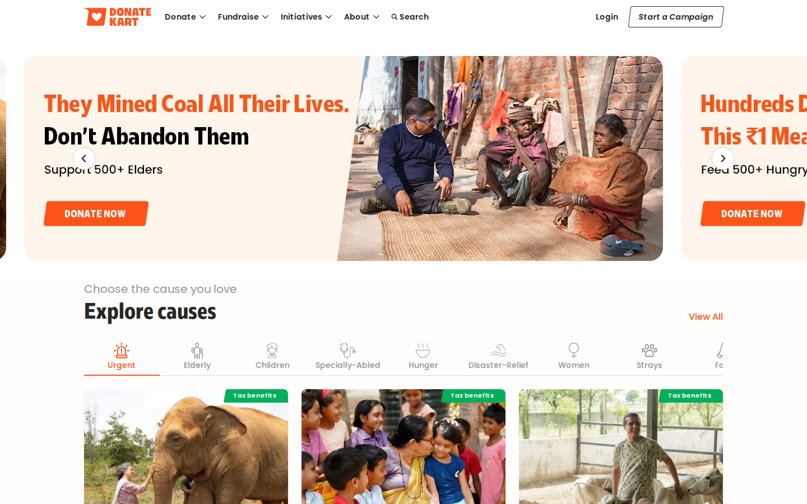

### 17% scroll depth

*Scroll position: 1282px of 8440px total*

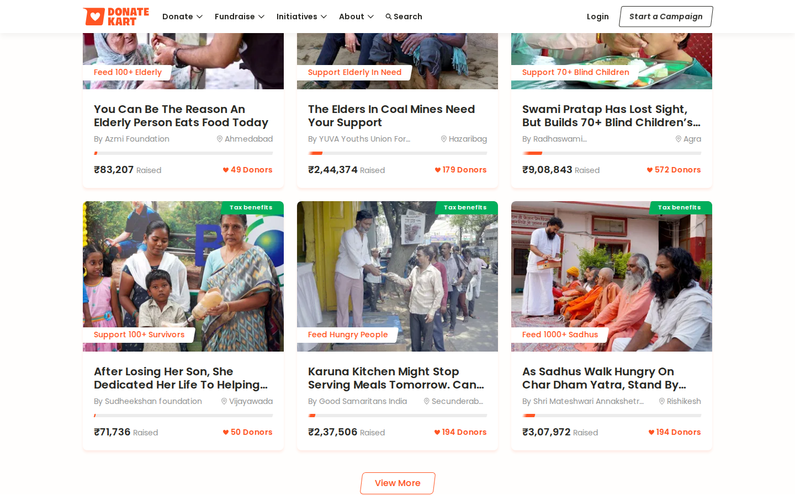

### 33% scroll depth

*Scroll position: 2488px of 8440px total*

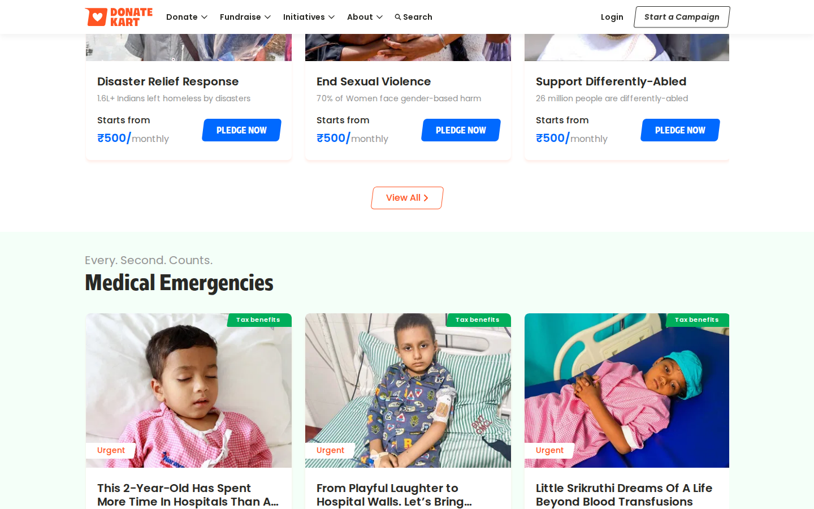

### 50% scroll depth

*Scroll position: 3770px of 8440px total*

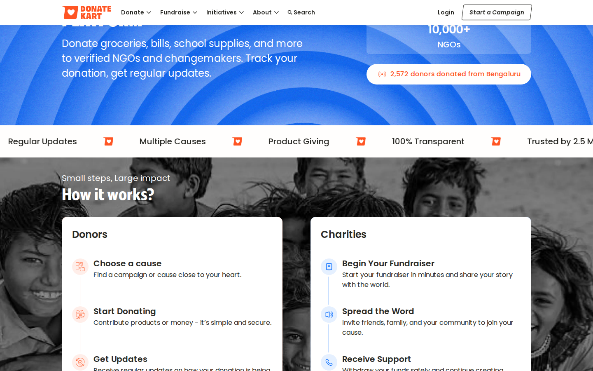

### 67% scroll depth

*Scroll position: 5052px of 8440px total*

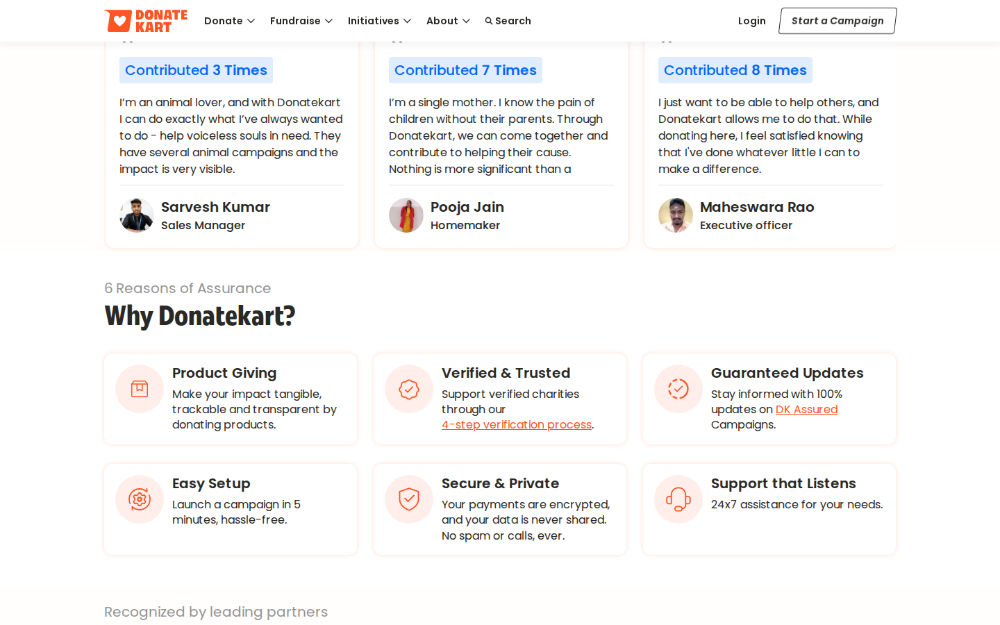

### 83% scroll depth

*Scroll position: 6258px of 8440px total*

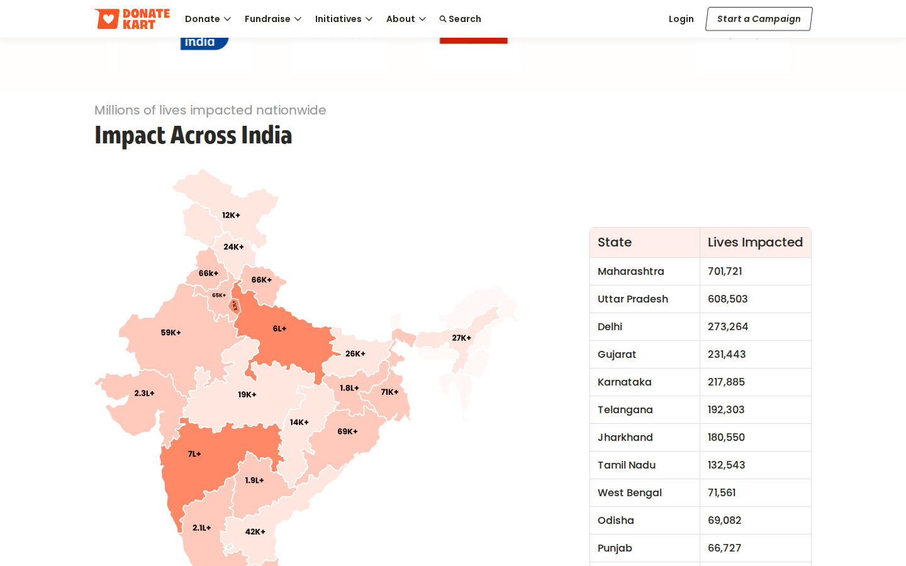

### Footer — End of page

*Scroll position: 7540px of 8440px total*

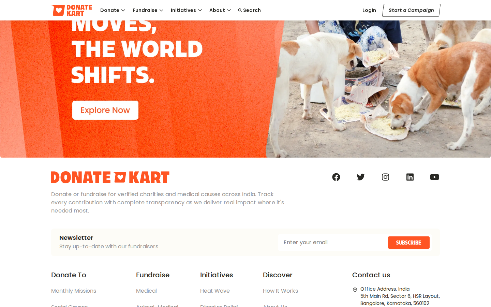

## Full Page Screenshots

### India's Most Trusted Donation Platform | DonateKart

*URL: `https://www.donatekart.com/`*

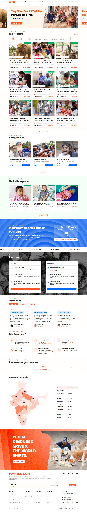

### Disaster Relief Response | DonateKart

*URL: `https://www.donatekart.com/monthlygiving/DSTR-001?utm_source=Website&utm_medium=MonthlyGiving&utm_campaign=menu-mission`*

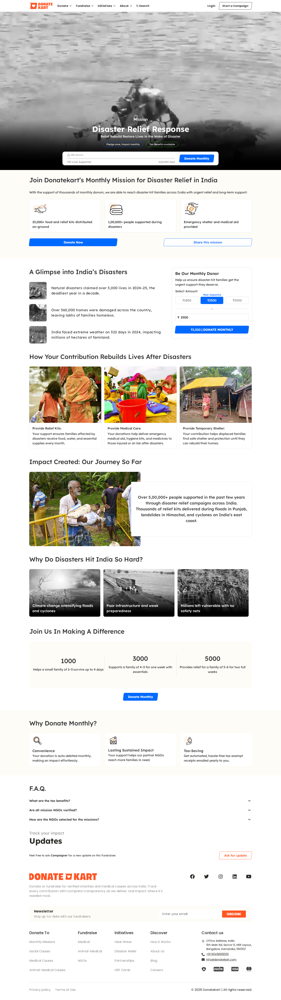

### Feed Elderly Sadhus | DonateKart

*URL: `https://www.donatekart.com/monthlygiving/Help-sadhus-every-month?utm_source=Website&utm_medium=MonthlyGiving&utm_campaign=menu-mission`*

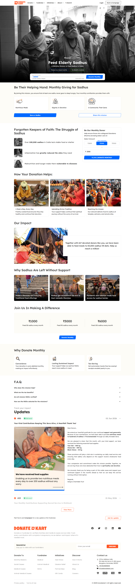

### Protect Abandoned Elders | DonateKart

*URL: `https://www.donatekart.com/monthlygiving/EM003?utm_source=Website&utm_medium=Menu&utm_campaign=menu-mission`*

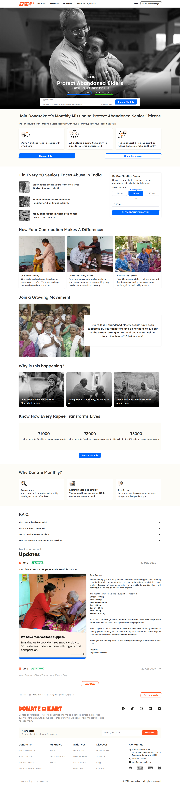

### Feed The Hungry | DonateKart

*URL: `https://www.donatekart.com/monthlygiving/NSHM002?utm_source=Website&utm_medium=Menu&utm_campaign=menu-mission`*

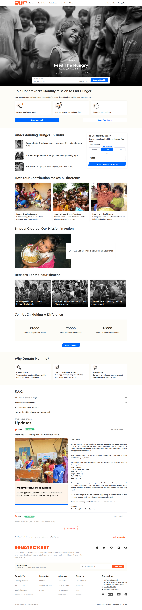

## Section Screenshots

Clipped sections showing individual components in context.

### Section 1 — `section`

*1440×446px*

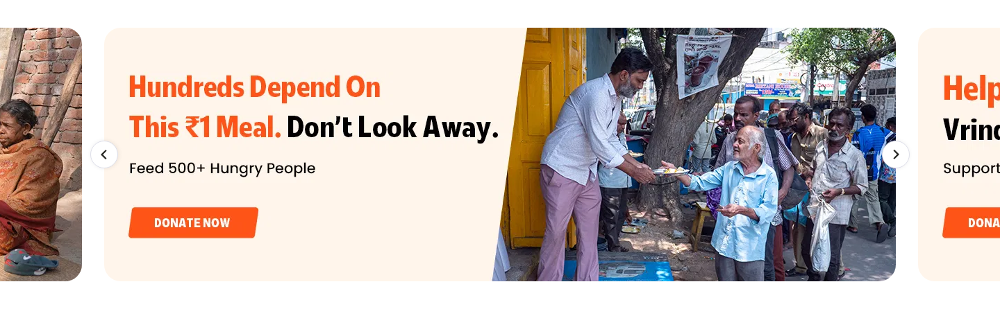

### Section 2 — `section`

*1440×1200px*

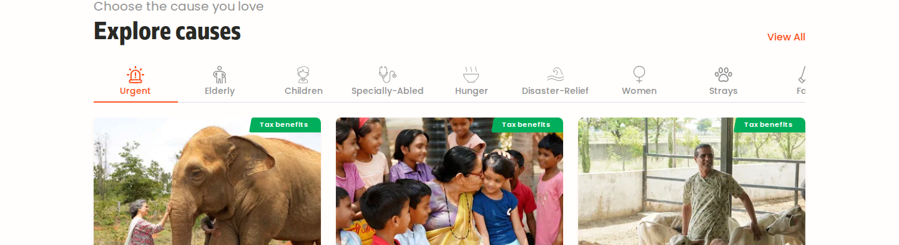

### Section 1 — `section`

*1440×810px*

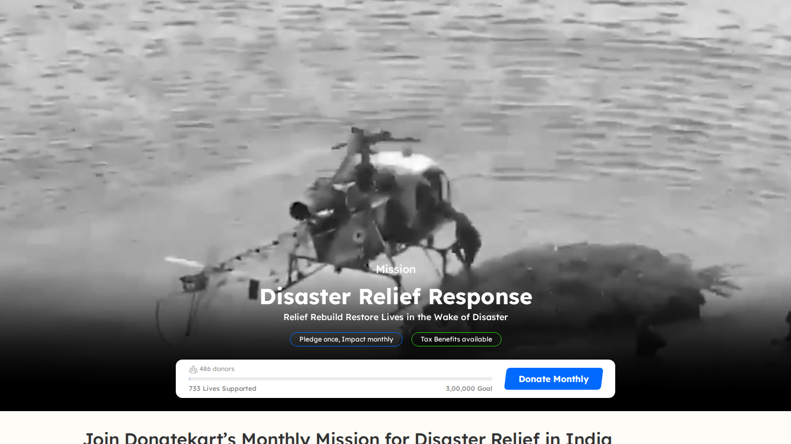

### Section 1 — `section`

*1440×810px*

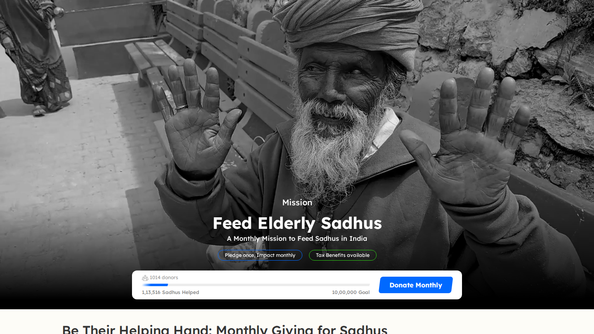

### Section 1 — `section`

*1440×810px*

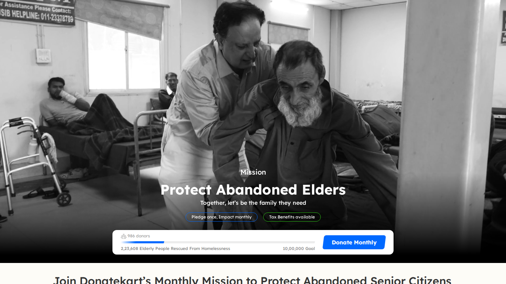

### Section 1 — `section`

*1440×810px*

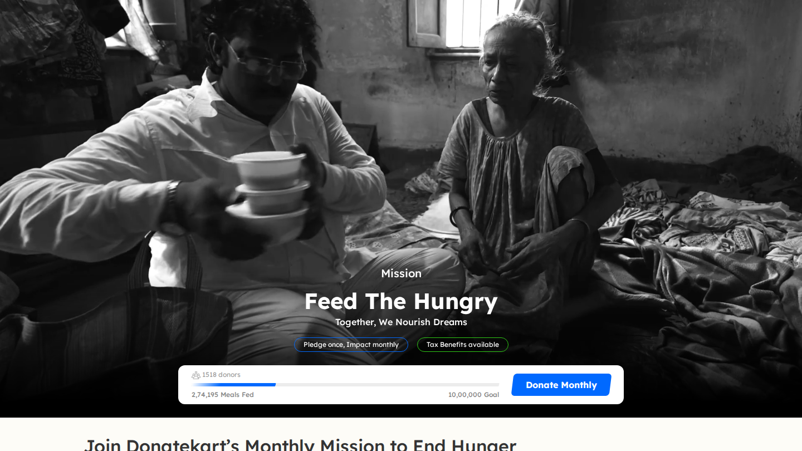

